# Index comparison: measured results

Commit `59f2bac41f98c35e3519bc57b94d574952f7cafd`. Profile: **focused**. Run status: **complete**. Started 2026-11-02T05:49:55Z; completed 2026-11-02T05:58:57Z.

2,758 timed observations, 394 successful exact result-multiset checks, **0 recorded errors**, and **0 explicitly unmeasured configurations** after maintenance failures. A correctness check is separate from EXPLAIN timing; the suite does not mistake an aggregate's output row count for a proof of correctness. An operation timeout is a failed attempt, not a successful duration; dependent checks are skipped and identified below.

**Build failures:** 0 recorded failed index builds. Statements have a 60-second limit. A failed index is omitted from the remaining portfolio and is not retried in subsequent build rounds; the family remains explicitly partial. Query results for that family use its surviving indexes or a planner fallback. They are **not measurements of the missing index**. See the completeness column and individual-index status below. Resume history and any earlier fatal attempt are preserved in metadata.

Hardware: **AMD Ryzen 7 5700X3D 8-Core Processor**, 16 logical CPUs, 23.47 GiB visible RAM. Server: `PostgreSQL 18.6 (Ubuntu 18.6-1.pgdg24.04+2) on x86_64-pc-linux-gnu, compiled by gcc (Ubuntu 13.3.0-6ubuntu2~24.04.1) 13.3.0, 64-bit`. Platform: `Linux-6.18.54.1-microsoft-standard-WSL2-x86_64-with-glibc2.39`. See [metadata.json](metadata.json) for compiler flags, all server settings, seed, and run arguments. Shared buffers are 512 MB; normal work_mem is 64 MB and maintenance_work_mem is 512 MB. Parallel query and JIT are disabled to isolate access paths; index builds use the recorded maintenance-worker setting. Durability is enabled. Autovacuum is disabled; vacuum and visibility transitions are explicit.

This is a synthetic, single-machine comparison, inspired by the presentation of the [Biscuit benchmark](https://biscuit.readthedocs.io/en/latest/benchmark.html). It measures this extension's integer, array, and full-text workloads, not Biscuit's wildcard workload. The data and workload SQL are in [queries.json](queries.json); generation and execution are in the [runner](../../comprehensive/run.py).

## Interpretation and fairness

Each selected scalar family attempts the same single-column portfolio on a freshly generated heap: seven indexes in the focused profile, eight in the full profile. The focused profile omits `clustered`; its document portfolio omits `grp`. Exact definitions are saved in `queries.json`. If selected, `btree_tuned` additionally receives a composite `(c200,c20,c2)` index and a covering `(c200) INCLUDE (id,payload)` index; its larger portfolio is charged in build time, bytes, and maintenance. Scalar GIN and GiST use `btree_gin` and `btree_gist`. GIN fastupdate is on; BRIN uses 32-page ranges. Roaring uses extension defaults. `roaring_bitmap` reuses the roaring portfolio with count pushdown disabled. `roaring_btree` is the roaring portfolio plus a B-tree on `c1m`, the ORDER BY column of the `ordered_*` cases, and measures only those cases: with the B-tree beside the lion indexes the planner may choose the LionOrdered scan (the lion filter's TID set tested against a walk of the B-tree), core's ordered B-tree walk, or a lion bitmap and a Sort.

Focused document comparisons use GIN and roaring for text arrays and full-text search. The full profile also includes GiST text search; GiST has no text[] containment opclass here, so its array queries are fallbacks. The range and ordered-LIMIT cases measure distinct access patterns: consult the recorded plans for LionCount, bitmap scans, or sequential fallbacks. Lion indexes do not return rows in order themselves; with a B-tree on the ORDER BY column (`roaring_btree`) the LionOrdered scan walks that B-tree and filters it with lion's answer. Sequential execution is always the correctness reference, but is timed as a separate portfolio only when `seq` is selected. This suite does not claim coverage of geometric, vector, JSON, wildcard, or arbitrary extension indexes.

`default` uses normal planner preferences. `prefer_index` disables sequential scans as a diagnostic; it is not a production tuning recommendation and does not guarantee use of an index. The access column and raw plans identify the actual route. A fallback is a query execution result, not a successful measurement of the named index algorithm.

Each query is verified against a forced sequential-scan result, warmed independently, and measured in randomized complete rounds within a portfolio. Families are shuffled with a fixed seed. Families run sequentially; there is no interleaved cross-family crossover trial. Warm means no deliberate cache eviction, **not a guarantee that the working set fits shared buffers**. `shared_buffers_cold` restarts the dedicated server before each measured query; the OS page cache remains warm, and planning can warm metadata pages before execution. No claim about cold physical-disk performance is made.

`clean` follows VACUUM FREEZE. The focused profile dirties every hundredth row's non-indexed payload directly from the clean state. The full profile first measures `dirty_clustered_5pct` (the first 5% of rows updated), then adds scattered updates. Dirty-state timings from the two profiles are not interchangeable. [operations.jsonl](operations.jsonl) records measured all-visible and heap-page counts. `low_work_mem` uses 64 kB and records lossy bitmap/temp-block evidence in [samples.jsonl](samples.jsonl). The normal setting is 64 MB. Maintenance is measured once per portfolio, with a checkpoint before each operation; WAL includes full-page images and index WAL. Insert batches contain 1% of initial rows; indexed updates affect the first 1%, and deletes use `id % 100 = 1`. Both profiles measure VACUUM; only the full profile adds REINDEX. Build repeats are recorded separately.

Read latency is server EXPLAIN ANALYZE execution time with per-node timing off, including EXPLAIN instrumentation but excluding planning and result transfer. Planning time and full buffer/WAL plans are retained in [samples.jsonl](samples.jsonl) and [plans.jsonl.gz](plans.jsonl.gz). Medians, interpolated p95, sample CV, and a seeded 2,000-resample percentile bootstrap 95% CI of the median are shown. With few samples, especially cold samples, intervals and p95 are descriptive and imprecise. Speedups divide matching sequential-scan medians by the variant median; they are not cross-workload averages. Sub-millisecond ratios are especially sensitive to timer resolution and instrumentation overhead. Timeout/error observations remain errors and are excluded from latency summaries, never converted to zero.

Concurrency measures closed-loop SELECTs through Python threads and synchronous libpq, including client dispatch, result transfer, and decoding. It can become client-bound for very fast counts; it is not a maximum server-throughput claim. The separate growth/churn/write supplement (`stress.py`) covers empty-index growth, changing-key churn, prepared statements, fully dirty low-memory counts, and short concurrent-write bursts. Crash recovery, replication, filesystem cache eviction, repeated maintenance trials, variable GIN pending-list settings, and tuning sweeps remain outside these runs. The benchmark is exhaustive over its published matrix, not every PostgreSQL workload.

Storage columns labeled Heap MiB use `pg_table_size`, including auxiliary forks and any TOAST storage; portfolio bytes use `pg_indexes_size`. Individual-index bytes use `pg_relation_size` (main fork). MiB means 1,048,576 bytes.

## Size and build cost

| Suite | Rows | Family | Heap MiB | Indexes MiB | Median build seconds | Build rounds | Completeness / omitted indexes |
| --- | --- | --- | --- | --- | --- | --- | --- |
| documents | 200000 | gin | 52.05 | 6.38 | 0.310 | 1 | complete |
| documents | 200000 | roaring | 52.05 | 12.07 | 0.308 | 1 | complete |
| scalar | 1000000 | btree | 150.57 | 58.98 | 1.907 | 1 | complete |
| scalar | 1000000 | gin | 150.57 | 58.68 | 2.319 | 1 | complete |
| scalar | 1000000 | roaring | 150.57 | 39.12 | 1.275 | 1 | complete |
| scalar | 1000000 | roaring_btree | 150.57 | 57.93 | 1.850 | 1 | complete |
| scalar | 5000000 | btree | 751.73 | 256.29 | 11.669 | 1 | complete |
| scalar | 5000000 | gin | 751.73 | 156.95 | 8.379 | 1 | complete |
| scalar | 5000000 | roaring | 751.73 | 118.02 | 5.354 | 1 | complete |
| scalar | 5000000 | roaring_btree | 751.73 | 174.28 | 7.532 | 1 | complete |

## Every individual index

| Suite | Rows | Family | Index | MiB | Median attempt ms | Min–max attempt ms | Median WAL MiB | Attempts | Status |
| --- | --- | --- | --- | --- | --- | --- | --- | --- | --- |
| documents | 200000 | gin | ix_tags | 2.070 | 107.104 | 107.104–107.104 | 1.355 | 1 | built |
| documents | 200000 | gin | ix_tsv | 4.305 | 202.777 | 202.777–202.777 | 2.680 | 1 | built |
| documents | 200000 | roaring | ix_tags | 2.062 | 88.611 | 88.611–88.611 | 1.641 | 1 | built |
| documents | 200000 | roaring | ix_tsv | 10.008 | 219.556 | 219.556–219.556 | 8.007 | 1 | built |
| scalar | 1000000 | btree | ix_c1m | 18.812 | 278.152 | 278.152–278.152 | 17.070 | 1 | built |
| scalar | 1000000 | btree | ix_c2 | 6.633 | 288.208 | 288.208–288.208 | 6.040 | 1 | built |
| scalar | 1000000 | btree | ix_c20 | 6.641 | 275.527 | 275.527–275.527 | 6.039 | 1 | built |
| scalar | 1000000 | btree | ix_c200 | 6.719 | 297.153 | 297.153–297.153 | 6.043 | 1 | built |
| scalar | 1000000 | btree | ix_c20k | 6.805 | 253.204 | 253.204–253.204 | 6.324 | 1 | built |
| scalar | 1000000 | btree | ix_nullable | 6.719 | 265.365 | 265.365–265.365 | 6.046 | 1 | built |
| scalar | 1000000 | btree | ix_skew | 6.656 | 249.685 | 249.685–249.685 | 6.048 | 1 | built |
| scalar | 1000000 | gin | ix_c1m | 38.195 | 1406.207 | 1406.207–1406.207 | 19.481 | 1 | built |
| scalar | 1000000 | gin | ix_c2 | 1.094 | 116.802 | 116.802–116.802 | 1.143 | 1 | built |
| scalar | 1000000 | gin | ix_c20 | 1.578 | 122.450 | 122.450–122.450 | 1.414 | 1 | built |
| scalar | 1000000 | gin | ix_c200 | 4.703 | 144.904 | 144.904–144.904 | 2.064 | 1 | built |
| scalar | 1000000 | gin | ix_c20k | 6.734 | 261.760 | 261.760–261.760 | 3.582 | 1 | built |
| scalar | 1000000 | gin | ix_nullable | 4.836 | 141.314 | 141.314–141.314 | 2.024 | 1 | built |
| scalar | 1000000 | gin | ix_skew | 1.539 | 125.796 | 125.796–125.796 | 1.298 | 1 | built |
| scalar | 1000000 | roaring | ix_c1m | 25.102 | 625.468 | 625.468–625.468 | 22.748 | 1 | built |
| scalar | 1000000 | roaring | ix_c2 | 0.406 | 95.867 | 95.867–95.867 | 0.390 | 1 | built |
| scalar | 1000000 | roaring | ix_c20 | 2.359 | 89.570 | 89.570–89.570 | 2.097 | 1 | built |
| scalar | 1000000 | roaring | ix_c200 | 3.523 | 105.794 | 105.794–105.794 | 2.891 | 1 | built |
| scalar | 1000000 | roaring | ix_c20k | 3.828 | 165.550 | 165.550–165.550 | 3.516 | 1 | built |
| scalar | 1000000 | roaring | ix_nullable | 3.336 | 105.066 | 105.066–105.066 | 2.850 | 1 | built |
| scalar | 1000000 | roaring | ix_skew | 0.562 | 87.749 | 87.749–87.749 | 0.543 | 1 | built |
| scalar | 1000000 | roaring_btree | ix_c1m | 25.102 | 724.891 | 724.891–724.891 | 22.733 | 1 | built |
| scalar | 1000000 | roaring_btree | ix_c1m_btree | 18.812 | 281.058 | 281.058–281.058 | 17.057 | 1 | built |
| scalar | 1000000 | roaring_btree | ix_c2 | 0.406 | 194.299 | 194.299–194.299 | 0.395 | 1 | built |
| scalar | 1000000 | roaring_btree | ix_c20 | 2.359 | 113.042 | 113.042–113.042 | 2.097 | 1 | built |
| scalar | 1000000 | roaring_btree | ix_c200 | 3.523 | 135.252 | 135.252–135.252 | 2.891 | 1 | built |
| scalar | 1000000 | roaring_btree | ix_c20k | 3.828 | 208.391 | 208.391–208.391 | 3.514 | 1 | built |
| scalar | 1000000 | roaring_btree | ix_nullable | 3.336 | 105.216 | 105.216–105.216 | 2.833 | 1 | built |
| scalar | 1000000 | roaring_btree | ix_skew | 0.562 | 88.172 | 88.172–88.172 | 0.526 | 1 | built |
| scalar | 5000000 | btree | ix_c1m | 56.258 | 1869.499 | 1869.499–1869.499 | 51.024 | 1 | built |
| scalar | 5000000 | btree | ix_c2 | 33.062 | 1425.017 | 1425.017–1425.017 | 29.932 | 1 | built |
| scalar | 5000000 | btree | ix_c20 | 33.070 | 1575.723 | 1575.723–1575.723 | 29.925 | 1 | built |
| scalar | 5000000 | btree | ix_c200 | 33.148 | 1973.690 | 1973.690–1973.690 | 29.929 | 1 | built |
| scalar | 5000000 | btree | ix_c20k | 34.383 | 1881.977 | 1881.977–1881.977 | 30.078 | 1 | built |
| scalar | 5000000 | btree | ix_nullable | 33.148 | 1580.369 | 1580.369–1580.369 | 29.932 | 1 | built |
| scalar | 5000000 | btree | ix_skew | 33.219 | 1362.395 | 1362.395–1362.395 | 29.937 | 1 | built |
| scalar | 5000000 | gin | ix_c1m | 87.367 | 4153.142 | 4153.142–4153.142 | 44.593 | 1 | built |
| scalar | 5000000 | gin | ix_c2 | 5.297 | 512.377 | 512.377–512.377 | 5.218 | 1 | built |
| scalar | 5000000 | gin | ix_c20 | 7.047 | 593.724 | 593.724–593.724 | 6.796 | 1 | built |
| scalar | 5000000 | gin | ix_c200 | 12.516 | 698.758 | 698.758–698.758 | 10.003 | 1 | built |
| scalar | 5000000 | gin | ix_c20k | 26.281 | 1116.875 | 1116.875–1116.875 | 15.403 | 1 | built |
| scalar | 5000000 | gin | ix_nullable | 11.562 | 669.245 | 669.245–669.245 | 9.769 | 1 | built |
| scalar | 5000000 | gin | ix_skew | 6.883 | 635.166 | 635.166–635.166 | 6.087 | 1 | built |
| scalar | 5000000 | roaring | ix_c1m | 52.742 | 2164.060 | 2164.060–2164.060 | 47.737 | 1 | built |
| scalar | 5000000 | roaring | ix_c2 | 1.844 | 469.659 | 469.659–469.659 | 1.600 | 1 | built |
| scalar | 5000000 | roaring | ix_c20 | 11.688 | 495.988 | 495.988–495.988 | 10.183 | 1 | built |
| scalar | 5000000 | roaring | ix_c200 | 15.773 | 508.639 | 508.639–508.639 | 14.088 | 1 | built |
| scalar | 5000000 | roaring | ix_c20k | 16.930 | 719.025 | 719.025–719.025 | 15.175 | 1 | built |
| scalar | 5000000 | roaring | ix_nullable | 16.555 | 533.306 | 533.306–533.306 | 13.892 | 1 | built |
| scalar | 5000000 | roaring | ix_skew | 2.492 | 463.038 | 463.038–463.038 | 2.278 | 1 | built |
| scalar | 5000000 | roaring_btree | ix_c1m | 52.742 | 2541.716 | 2541.716–2541.716 | 47.746 | 1 | built |
| scalar | 5000000 | roaring_btree | ix_c1m_btree | 56.258 | 1872.870 | 1872.870–1872.870 | 51.037 | 1 | built |
| scalar | 5000000 | roaring_btree | ix_c2 | 1.844 | 447.679 | 447.679–447.679 | 1.602 | 1 | built |
| scalar | 5000000 | roaring_btree | ix_c20 | 11.688 | 473.825 | 473.825–473.825 | 10.192 | 1 | built |
| scalar | 5000000 | roaring_btree | ix_c200 | 15.773 | 502.804 | 502.804–502.804 | 14.098 | 1 | built |
| scalar | 5000000 | roaring_btree | ix_c20k | 16.930 | 715.554 | 715.554–715.554 | 15.184 | 1 | built |
| scalar | 5000000 | roaring_btree | ix_nullable | 16.555 | 521.388 | 521.388–521.388 | 13.909 | 1 | built |
| scalar | 5000000 | roaring_btree | ix_skew | 2.492 | 456.537 | 456.537–456.537 | 2.295 | 1 | built |

## Measured visibility

| Suite | Rows | Family | State | Heap pages | All-visible pages | All-visible % |
| --- | --- | --- | --- | --- | --- | --- |
| scalar | 1000000 | roaring_btree | clean | 19264 | 19231 | 99.83 |
| scalar | 1000000 | gin | clean | 19264 | 19231 | 99.83 |
| scalar | 1000000 | gin | dirty_scattered | 19264 | 9231 | 47.92 |
| scalar | 1000000 | btree | clean | 19264 | 19231 | 99.83 |
| scalar | 1000000 | btree | dirty_scattered | 19264 | 9231 | 47.92 |
| scalar | 1000000 | roaring | clean | 19264 | 19231 | 99.83 |
| scalar | 1000000 | roaring | dirty_scattered | 19264 | 9231 | 47.92 |
| scalar | 5000000 | btree | clean | 96192 | 96154 | 99.96 |
| scalar | 5000000 | btree | dirty_scattered | 96192 | 46154 | 47.98 |
| scalar | 5000000 | roaring_btree | clean | 96192 | 96154 | 99.96 |
| scalar | 5000000 | roaring | clean | 96192 | 96154 | 99.96 |
| scalar | 5000000 | roaring | dirty_scattered | 96192 | 46154 | 47.98 |
| scalar | 5000000 | gin | clean | 96192 | 96154 | 99.96 |
| scalar | 5000000 | gin | dirty_scattered | 96192 | 46154 | 47.98 |
| documents | 200000 | gin | clean | 6656 | 6628 | 99.58 |
| documents | 200000 | roaring | clean | 6656 | 6628 | 99.58 |

## Selected plots

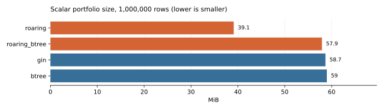

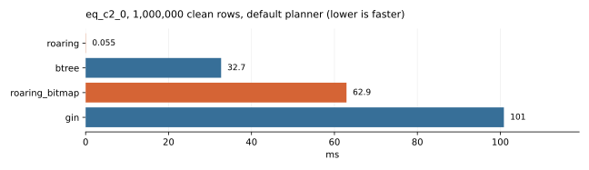

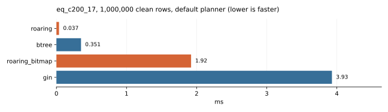

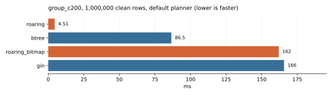

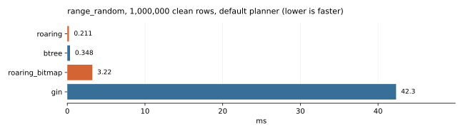

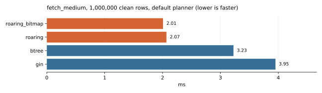

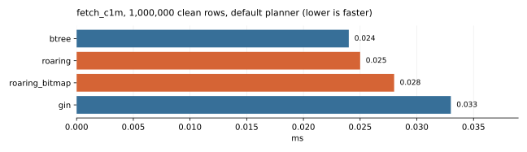

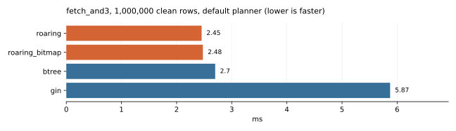

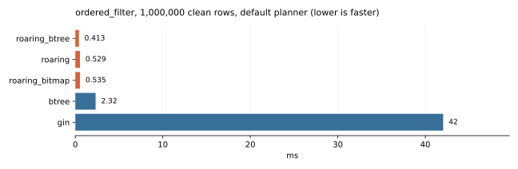

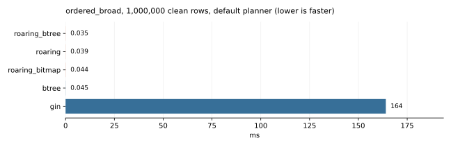

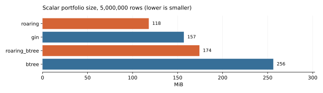

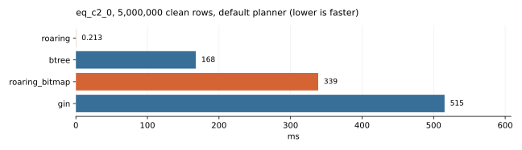

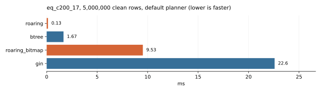

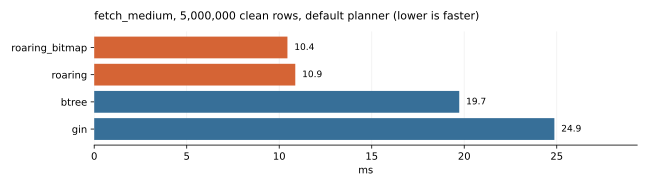

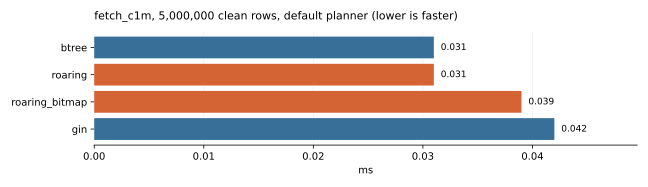

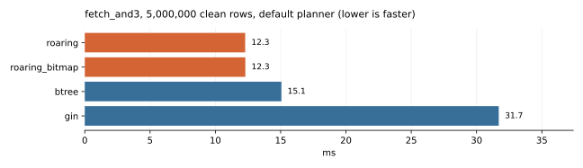

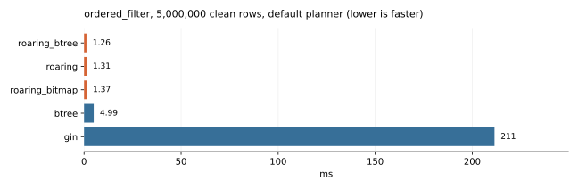

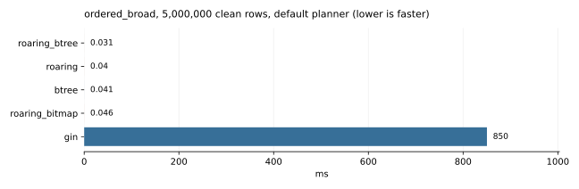

## Maintenance (single observations)

| Rows | Family | Operation | Elapsed attempt ms | WAL MiB | Indexes MiB after | Status |
| --- | --- | --- | --- | --- | --- | --- |
| 1000000 | gin | insert | 84.113 | 12.297 | 60.055 | ok |
| 1000000 | gin | indexed_update | 125.571 | 15.618 | 61.430 | ok |
| 1000000 | gin | delete | 140.478 | 73.227 | 61.430 | ok |
| 1000000 | gin | vacuum | 483.144 | 141.275 | 61.680 | ok |
| 1000000 | btree | insert | 163.791 | 32.628 | 59.383 | ok |
| 1000000 | btree | indexed_update | 289.427 | 36.893 | 59.750 | ok |
| 1000000 | btree | delete | 130.086 | 73.227 | 59.750 | ok |
| 1000000 | btree | vacuum | 383.895 | 133.799 | 59.750 | ok |
| 1000000 | roaring | insert | 277.259 | 34.864 | 39.117 | ok |
| 1000000 | roaring | indexed_update | 319.667 | 41.887 | 39.383 | ok |
| 1000000 | roaring | delete | 138.031 | 73.227 | 39.383 | ok |
| 1000000 | roaring | vacuum | 423.194 | 115.403 | 39.383 | ok |
| 5000000 | btree | insert | 1054.493 | 119.585 | 260.078 | ok |
| 5000000 | btree | indexed_update | 1478.738 | 138.530 | 263.102 | ok |
| 5000000 | btree | delete | 650.948 | 366.125 | 263.102 | ok |
| 5000000 | btree | vacuum | 1427.431 | 634.381 | 263.102 | ok |
| 5000000 | roaring | insert | 1526.240 | 103.745 | 120.617 | ok |
| 5000000 | roaring | indexed_update | 1731.696 | 124.933 | 123.062 | ok |
| 5000000 | roaring | delete | 658.945 | 366.125 | 123.062 | ok |
| 5000000 | roaring | vacuum | 1454.268 | 507.176 | 123.062 | ok |
| 5000000 | gin | insert | 375.166 | 61.368 | 163.719 | ok |
| 5000000 | gin | indexed_update | 606.757 | 77.890 | 170.484 | ok |
| 5000000 | gin | delete | 644.652 | 366.125 | 170.484 | ok |
| 5000000 | gin | vacuum | 1816.269 | 587.332 | 172.297 | ok |

## Concurrent reads

| Rows | Variant | Clients | Query | Transactions/s | Median ms | p95 ms | Duration s |
| --- | --- | --- | --- | --- | --- | --- | --- |

## Every query and configuration

| Suite | Rows | State | Planner | work_mem | Query | Variant | n | Execution median ms | 95% CI ms | p95 ms | CV | Speedup vs seq | Access | Planning median ms | Plan+execution median ms |
| --- | --- | --- | --- | --- | --- | --- | --- | --- | --- | --- | --- | --- | --- | --- | --- |
| documents | 200000 | clean | default | 64MB | array_and | gin | 7 | 1.048 | 1.033–1.058 | 1.083 | 2.2% | — | Bitmap Heap Scan, Bitmap Index Scan | 0.060 | 1.115 |
| documents | 200000 | clean | default | 64MB | array_and | roaring | 7 | 0.073 | 0.072–0.074 | 0.082 | 6.5% | — | LionCount | 0.113 | 0.190 |
| documents | 200000 | clean | default | 64MB | array_and | roaring_bitmap | 7 | 0.131 | 0.128–0.139 | 0.161 | 11.0% | — | Index Scan | 0.070 | 0.200 |
| documents | 200000 | clean | default | 64MB | array_common | gin | 7 | 4.353 | 4.325–4.402 | 5.648 | 15.1% | — | Bitmap Heap Scan, Bitmap Index Scan | 0.061 | 4.414 |
| documents | 200000 | clean | default | 64MB | array_common | roaring | 7 | 0.031 | 0.030–0.032 | 0.035 | 7.9% | — | LionCount | 0.107 | 0.141 |
| documents | 200000 | clean | default | 64MB | array_common | roaring_bitmap | 7 | 2.195 | 2.140–2.257 | 3.343 | 25.6% | — | Index Scan | 0.068 | 2.263 |
| documents | 200000 | clean | default | 64MB | array_or | gin | 7 | 7.199 | 7.087–7.330 | 7.901 | 5.3% | — | Bitmap Heap Scan, Bitmap Index Scan | 0.061 | 7.261 |
| documents | 200000 | clean | default | 64MB | array_or | roaring | 7 | 0.107 | 0.098–0.113 | 0.131 | 13.9% | — | LionCount | 0.114 | 0.219 |
| documents | 200000 | clean | default | 64MB | array_or | roaring_bitmap | 7 | 5.699 | 5.657–5.711 | 5.725 | 0.6% | — | Bitmap Heap Scan, Bitmap Index Scan | 0.070 | 5.769 |
| documents | 200000 | clean | default | 64MB | ts_and | gin | 7 | 1.144 | 1.135–1.161 | 1.209 | 3.2% | — | Bitmap Heap Scan, Bitmap Index Scan | 0.051 | 1.196 |
| documents | 200000 | clean | default | 64MB | ts_and | roaring | 7 | 0.075 | 0.073–0.077 | 0.077 | 2.9% | — | LionCount | 0.100 | 0.175 |
| documents | 200000 | clean | default | 64MB | ts_and | roaring_bitmap | 7 | 0.133 | 0.132–0.135 | 0.178 | 16.7% | — | Index Scan | 0.061 | 0.194 |
| documents | 200000 | clean | default | 64MB | ts_common | gin | 7 | 31.819 | 31.254–35.907 | 36.935 | 7.4% | — | Seq Scan (fallback) | 0.051 | 31.868 |
| documents | 200000 | clean | default | 64MB | ts_common | roaring | 7 | 0.039 | 0.039–0.039 | 0.048 | 12.3% | — | LionCount | 0.096 | 0.135 |
| documents | 200000 | clean | default | 64MB | ts_common | roaring_bitmap | 7 | 31.617 | 31.270–36.259 | 37.844 | 9.0% | — | Seq Scan (fallback) | 0.059 | 31.679 |
| documents | 200000 | clean | default | 64MB | ts_fetch | gin | 7 | 4.828 | 4.742–4.900 | 4.991 | 2.2% | — | Bitmap Heap Scan, Bitmap Index Scan | 0.056 | 4.883 |
| documents | 200000 | clean | default | 64MB | ts_fetch | roaring | 7 | 2.623 | 2.586–2.700 | 2.720 | 2.1% | — | Index Scan | 0.068 | 2.688 |
| documents | 200000 | clean | default | 64MB | ts_fetch | roaring_bitmap | 7 | 2.679 | 2.628–2.709 | 2.731 | 1.9% | — | Index Scan | 0.063 | 2.752 |
| documents | 200000 | clean | default | 64MB | ts_not | gin | 7 | 38.989 | 38.238–42.470 | 44.786 | 7.2% | — | Seq Scan (fallback) | 0.051 | 39.040 |
| documents | 200000 | clean | default | 64MB | ts_not | roaring | 7 | 9.541 | 9.520–9.632 | 9.635 | 0.6% | — | LionCount | 0.228 | 9.803 |
| documents | 200000 | clean | default | 64MB | ts_not | roaring_bitmap | 7 | 39.011 | 38.528–39.953 | 42.372 | 4.7% | — | Seq Scan (fallback) | 0.188 | 39.230 |
| documents | 200000 | clean | default | 64MB | ts_phrase | gin | 7 | 7.602 | 7.505–7.670 | 10.124 | 16.9% | — | Bitmap Heap Scan, Bitmap Index Scan | 0.051 | 7.654 |
| documents | 200000 | clean | default | 64MB | ts_phrase | roaring | 7 | 2.519 | 2.502–2.695 | 3.189 | 12.4% | — | LionCount | 0.468 | 3.000 |
| documents | 200000 | clean | default | 64MB | ts_phrase | roaring_bitmap | 7 | 4.743 | 4.665–4.819 | 7.060 | 24.0% | — | Index Scan | 0.432 | 5.192 |
| documents | 200000 | clean | default | 64MB | ts_prefix | gin | 7 | 1.721 | 1.704–1.735 | 1.762 | 1.7% | — | Bitmap Heap Scan, Bitmap Index Scan | 0.054 | 1.775 |
| documents | 200000 | clean | default | 64MB | ts_prefix | roaring | 7 | 0.632 | 0.625–0.641 | 0.649 | 2.4% | — | LionCount | 0.097 | 0.735 |
| documents | 200000 | clean | default | 64MB | ts_prefix | roaring_bitmap | 7 | 1.325 | 1.295–1.384 | 1.435 | 4.5% | — | Index Scan | 0.062 | 1.384 |
| documents | 200000 | clean | default | 64MB | ts_rare | gin | 7 | 0.038 | 0.038–0.040 | 0.040 | 2.5% | — | Bitmap Heap Scan, Bitmap Index Scan | 0.054 | 0.094 |
| documents | 200000 | clean | default | 64MB | ts_rare | roaring | 7 | 0.019 | 0.018–0.020 | 0.020 | 5.9% | — | LionCount | 0.097 | 0.115 |
| documents | 200000 | clean | default | 64MB | ts_rare | roaring_bitmap | 7 | 0.037 | 0.033–0.040 | 0.041 | 8.7% | — | Index Scan | 0.059 | 0.098 |
| documents | 200000 | clean | default | 64MB | ts_tree | gin | 7 | 3.857 | 3.835–3.908 | 5.187 | 17.2% | — | Bitmap Heap Scan, Bitmap Index Scan | 0.051 | 3.926 |
| documents | 200000 | clean | default | 64MB | ts_tree | roaring | 7 | 0.178 | 0.178–0.216 | 0.219 | 10.0% | — | LionCount | 0.098 | 0.277 |
| documents | 200000 | clean | default | 64MB | ts_tree | roaring_bitmap | 7 | 0.486 | 0.472–0.489 | 0.520 | 4.6% | — | Index Scan | 0.062 | 0.549 |
| documents | 200000 | clean | default | 64MB | ts_weight | gin | 7 | 5.397 | 5.332–5.474 | 5.883 | 4.8% | — | Bitmap Heap Scan, Bitmap Index Scan | 0.050 | 5.447 |
| documents | 200000 | clean | default | 64MB | ts_weight | roaring | 7 | 0.442 | 0.426–0.461 | 0.465 | 3.7% | — | LionCount | 0.163 | 0.613 |
| documents | 200000 | clean | default | 64MB | ts_weight | roaring_bitmap | 7 | 2.524 | 2.510–2.610 | 2.642 | 2.5% | — | Index Scan | 0.127 | 2.651 |
| scalar | 1000000 | after_maintenance | default | 64MB | and2 | btree | 7 | 3.472 | 3.116–3.985 | 4.063 | 12.2% | — | Bitmap Heap Scan, Bitmap Index Scan | 0.045 | 3.518 |
| scalar | 1000000 | after_maintenance | default | 64MB | and2 | gin | 7 | 40.131 | 39.480–41.792 | 45.246 | 6.4% | — | Bitmap Heap Scan, Bitmap Index Scan | 0.052 | 40.201 |
| scalar | 1000000 | after_maintenance | default | 64MB | and2 | roaring | 7 | 0.101 | 0.097–0.109 | 0.110 | 5.8% | — | LionCount | 0.105 | 0.207 |
| scalar | 1000000 | after_maintenance | default | 64MB | and2 | roaring_bitmap | 7 | 6.580 | 6.548–6.722 | 6.830 | 1.9% | — | Bitmap Heap Scan, Bitmap Index Scan | 0.081 | 6.657 |
| scalar | 1000000 | after_maintenance | default | 64MB | eq_c200_17 | btree | 7 | 0.353 | 0.344–0.382 | 0.565 | 28.1% | — | Index Only Scan | 0.039 | 0.394 |
| scalar | 1000000 | after_maintenance | default | 64MB | eq_c200_17 | gin | 7 | 4.009 | 3.616–4.413 | 5.603 | 20.4% | — | Bitmap Heap Scan, Bitmap Index Scan | 0.050 | 4.054 |
| scalar | 1000000 | after_maintenance | default | 64MB | eq_c200_17 | roaring | 7 | 0.037 | 0.036–0.038 | 0.038 | 3.0% | — | LionCount | 0.077 | 0.114 |
| scalar | 1000000 | after_maintenance | default | 64MB | eq_c200_17 | roaring_bitmap | 7 | 1.955 | 1.721–2.065 | 2.459 | 15.8% | — | Index Scan | 0.072 | 2.027 |
| scalar | 1000000 | after_maintenance | default | 64MB | group_c200 | btree | 7 | 86.934 | 83.029–90.020 | 93.946 | 5.6% | — | Index Only Scan | 0.041 | 86.975 |
| scalar | 1000000 | after_maintenance | default | 64MB | group_c200 | gin | 7 | 163.373 | 160.703–166.928 | 168.501 | 2.4% | — | Seq Scan (fallback) | 0.038 | 163.408 |
| scalar | 1000000 | after_maintenance | default | 64MB | group_c200 | roaring | 7 | 4.428 | 4.412–4.482 | 4.490 | 1.0% | — | LionCount | 0.053 | 4.480 |
| scalar | 1000000 | after_maintenance | default | 64MB | group_c200 | roaring_bitmap | 7 | 160.570 | 158.758–164.197 | 169.123 | 2.8% | — | Seq Scan (fallback) | 0.042 | 160.612 |
| scalar | 1000000 | after_maintenance | default | 64MB | is_null | btree | 7 | 6.113 | 6.090–6.209 | 6.249 | 1.2% | — | Index Only Scan | 0.034 | 6.146 |
| scalar | 1000000 | after_maintenance | default | 64MB | is_null | gin | 7 | 63.425 | 62.076–67.252 | 68.921 | 4.4% | — | Seq Scan (fallback) | 0.039 | 63.513 |
| scalar | 1000000 | after_maintenance | default | 64MB | is_null | roaring | 7 | 0.056 | 0.055–0.056 | 0.057 | 2.2% | — | LionCount | 0.056 | 0.111 |
| scalar | 1000000 | after_maintenance | default | 64MB | is_null | roaring_bitmap | 7 | 23.941 | 22.802–25.144 | 28.241 | 9.8% | — | Bitmap Heap Scan, Bitmap Index Scan | 0.046 | 23.983 |
| scalar | 1000000 | clean | default | 64MB | and2 | btree | 7 | 3.240 | 3.191–3.450 | 3.774 | 8.7% | — | Bitmap Heap Scan, Bitmap Index Scan | 0.044 | 3.299 |
| scalar | 1000000 | clean | default | 64MB | and2 | gin | 7 | 40.176 | 39.687–43.040 | 45.769 | 6.8% | — | Bitmap Heap Scan, Bitmap Index Scan | 0.047 | 40.221 |
| scalar | 1000000 | clean | default | 64MB | and2 | roaring | 7 | 0.100 | 0.097–0.101 | 0.128 | 14.6% | — | LionCount | 0.106 | 0.208 |
| scalar | 1000000 | clean | default | 64MB | and2 | roaring_bitmap | 7 | 6.572 | 6.529–6.951 | 7.085 | 4.3% | — | Bitmap Heap Scan, Bitmap Index Scan | 0.077 | 6.660 |
| scalar | 1000000 | clean | default | 64MB | and3_selective | btree | 7 | 0.346 | 0.338–0.363 | 0.406 | 8.7% | — | Bitmap Heap Scan, Bitmap Index Scan | 0.050 | 0.401 |
| scalar | 1000000 | clean | default | 64MB | and3_selective | gin | 7 | 0.645 | 0.623–0.702 | 0.741 | 7.7% | — | Bitmap Heap Scan, Bitmap Index Scan | 0.053 | 0.703 |
| scalar | 1000000 | clean | default | 64MB | and3_selective | roaring | 7 | 0.037 | 0.032–0.049 | 0.064 | 32.7% | — | LionCount | 0.121 | 0.157 |
| scalar | 1000000 | clean | default | 64MB | and3_selective | roaring_bitmap | 7 | 0.359 | 0.337–0.378 | 0.404 | 8.1% | — | Bitmap Heap Scan, Bitmap Index Scan | 0.095 | 0.455 |
| scalar | 1000000 | clean | default | 64MB | eq_c1m_12345 | btree | 7 | 0.020 | 0.019–0.020 | 0.021 | 4.8% | — | Index Only Scan | 0.038 | 0.057 |
| scalar | 1000000 | clean | default | 64MB | eq_c1m_12345 | gin | 7 | 0.028 | 0.027–0.029 | 0.032 | 8.6% | — | Bitmap Heap Scan, Bitmap Index Scan | 0.042 | 0.071 |
| scalar | 1000000 | clean | default | 64MB | eq_c1m_12345 | roaring | 7 | 0.016 | 0.015–0.016 | 0.016 | 3.4% | — | LionCount | 0.079 | 0.095 |
| scalar | 1000000 | clean | default | 64MB | eq_c1m_12345 | roaring_bitmap | 7 | 0.022 | 0.021–0.025 | 0.035 | 25.8% | — | Index Scan | 0.061 | 0.090 |
| scalar | 1000000 | clean | default | 64MB | eq_c200_17 | btree | 7 | 0.351 | 0.342–0.374 | 0.375 | 4.0% | — | Index Only Scan | 0.039 | 0.391 |
| scalar | 1000000 | clean | default | 64MB | eq_c200_17 | gin | 7 | 3.930 | 3.559–3.952 | 4.032 | 6.9% | — | Bitmap Heap Scan, Bitmap Index Scan | 0.040 | 3.973 |
| scalar | 1000000 | clean | default | 64MB | eq_c200_17 | roaring | 7 | 0.037 | 0.036–0.037 | 0.037 | 2.2% | — | LionCount | 0.077 | 0.114 |
| scalar | 1000000 | clean | default | 64MB | eq_c200_17 | roaring_bitmap | 7 | 1.921 | 1.783–2.211 | 2.525 | 15.8% | — | Index Scan | 0.059 | 1.980 |
| scalar | 1000000 | clean | default | 64MB | eq_c20k_123 | btree | 7 | 0.022 | 0.022–0.027 | 0.027 | 10.0% | — | Index Only Scan | 0.038 | 0.061 |
| scalar | 1000000 | clean | default | 64MB | eq_c20k_123 | gin | 7 | 0.067 | 0.060–0.079 | 0.094 | 21.2% | — | Bitmap Heap Scan, Bitmap Index Scan | 0.042 | 0.106 |
| scalar | 1000000 | clean | default | 64MB | eq_c20k_123 | roaring | 7 | 0.017 | 0.017–0.018 | 0.018 | 2.8% | — | LionCount | 0.080 | 0.097 |
| scalar | 1000000 | clean | default | 64MB | eq_c20k_123 | roaring_bitmap | 7 | 0.048 | 0.043–0.067 | 0.068 | 22.5% | — | Index Scan | 0.059 | 0.103 |
| scalar | 1000000 | clean | default | 64MB | eq_c2_0 | btree | 7 | 32.675 | 32.443–33.848 | 36.974 | 6.3% | — | Index Only Scan | 0.039 | 32.714 |
| scalar | 1000000 | clean | default | 64MB | eq_c2_0 | gin | 7 | 100.865 | 95.005–102.813 | 102.996 | 3.9% | — | Bitmap Heap Scan, Bitmap Index Scan | 0.039 | 100.899 |
| scalar | 1000000 | clean | default | 64MB | eq_c2_0 | roaring | 7 | 0.055 | 0.054–0.057 | 0.057 | 2.3% | — | LionCount | 0.073 | 0.129 |
| scalar | 1000000 | clean | default | 64MB | eq_c2_0 | roaring_bitmap | 7 | 62.911 | 61.214–65.327 | 65.630 | 3.1% | — | Bitmap Heap Scan, Bitmap Index Scan | 0.056 | 62.993 |
| scalar | 1000000 | clean | default | 64MB | eq_skew_0 | btree | 7 | 60.772 | 59.041–63.343 | 64.512 | 4.0% | — | Index Only Scan | 0.038 | 60.813 |
| scalar | 1000000 | clean | default | 64MB | eq_skew_0 | gin | 7 | 94.577 | 92.824–101.206 | 104.369 | 5.4% | — | Seq Scan (fallback) | 0.043 | 94.619 |
| scalar | 1000000 | clean | default | 64MB | eq_skew_0 | roaring | 7 | 0.056 | 0.055–0.058 | 0.082 | 22.2% | — | LionCount | 0.079 | 0.135 |
| scalar | 1000000 | clean | default | 64MB | eq_skew_0 | roaring_bitmap | 7 | 94.247 | 93.170–102.618 | 103.226 | 4.9% | — | Seq Scan (fallback) | 0.058 | 94.305 |
| scalar | 1000000 | clean | default | 64MB | eq_skew_17 | btree | 7 | 0.026 | 0.025–0.027 | 0.027 | 3.5% | — | Index Only Scan | 0.038 | 0.063 |
| scalar | 1000000 | clean | default | 64MB | eq_skew_17 | gin | 7 | 0.110 | 0.106–0.122 | 0.126 | 8.0% | — | Bitmap Heap Scan, Bitmap Index Scan | 0.041 | 0.151 |
| scalar | 1000000 | clean | default | 64MB | eq_skew_17 | roaring | 7 | 0.019 | 0.018–0.019 | 0.019 | 2.6% | — | LionCount | 0.078 | 0.097 |
| scalar | 1000000 | clean | default | 64MB | eq_skew_17 | roaring_bitmap | 7 | 0.081 | 0.078–0.086 | 0.163 | 45.4% | — | Index Scan | 0.060 | 0.142 |
| scalar | 1000000 | clean | default | 64MB | fetch_and2 | btree | 7 | 2.745 | 2.670–2.750 | 2.756 | 1.8% | — | Bitmap Heap Scan, Bitmap Index Scan | 0.048 | 2.793 |
| scalar | 1000000 | clean | default | 64MB | fetch_and2 | gin | 7 | 6.032 | 5.988–6.348 | 6.435 | 3.2% | — | Bitmap Heap Scan, Bitmap Index Scan | 0.053 | 6.085 |
| scalar | 1000000 | clean | default | 64MB | fetch_and2 | roaring | 7 | 2.435 | 2.388–2.558 | 2.830 | 8.1% | — | Bitmap Heap Scan, Bitmap Index Scan | 0.085 | 2.519 |
| scalar | 1000000 | clean | default | 64MB | fetch_and2 | roaring_bitmap | 7 | 2.466 | 2.422–2.563 | 2.618 | 3.8% | — | Bitmap Heap Scan, Bitmap Index Scan | 0.093 | 2.555 |
| scalar | 1000000 | clean | default | 64MB | fetch_and3 | btree | 7 | 2.700 | 2.687–2.797 | 2.878 | 3.5% | — | Bitmap Heap Scan, Bitmap Index Scan | 0.055 | 2.757 |
| scalar | 1000000 | clean | default | 64MB | fetch_and3 | gin | 7 | 5.872 | 5.754–5.920 | 6.056 | 2.1% | — | Bitmap Heap Scan, Bitmap Index Scan | 0.059 | 5.933 |
| scalar | 1000000 | clean | default | 64MB | fetch_and3 | roaring | 7 | 2.454 | 2.388–2.496 | 2.527 | 2.9% | — | Bitmap Heap Scan, Bitmap Index Scan | 0.103 | 2.567 |
| scalar | 1000000 | clean | default | 64MB | fetch_and3 | roaring_bitmap | 7 | 2.477 | 2.373–2.519 | 2.543 | 3.0% | — | Bitmap Heap Scan, Bitmap Index Scan | 0.106 | 2.583 |
| scalar | 1000000 | clean | default | 64MB | fetch_broad | btree | 7 | 19.423 | 18.066–21.459 | 26.891 | 18.9% | — | Bitmap Heap Scan, Bitmap Index Scan | 0.042 | 19.463 |
| scalar | 1000000 | clean | default | 64MB | fetch_broad | gin | 7 | 23.889 | 23.433–25.403 | 26.182 | 5.3% | — | Bitmap Heap Scan, Bitmap Index Scan | 0.045 | 23.935 |
| scalar | 1000000 | clean | default | 64MB | fetch_broad | roaring | 7 | 13.118 | 12.063–13.517 | 15.422 | 11.0% | — | Index Scan | 0.070 | 13.187 |
| scalar | 1000000 | clean | default | 64MB | fetch_broad | roaring_bitmap | 7 | 15.038 | 14.336–17.266 | 19.256 | 13.4% | — | Index Scan | 0.065 | 15.104 |
| scalar | 1000000 | clean | default | 64MB | fetch_c1m | btree | 7 | 0.024 | 0.023–0.026 | 0.027 | 7.4% | — | Index Scan | 0.040 | 0.065 |
| scalar | 1000000 | clean | default | 64MB | fetch_c1m | gin | 7 | 0.033 | 0.032–0.038 | 0.039 | 10.2% | — | Bitmap Heap Scan, Bitmap Index Scan | 0.045 | 0.078 |
| scalar | 1000000 | clean | default | 64MB | fetch_c1m | roaring | 7 | 0.025 | 0.023–0.025 | 0.026 | 5.2% | — | Index Scan | 0.068 | 0.091 |
| scalar | 1000000 | clean | default | 64MB | fetch_c1m | roaring_bitmap | 7 | 0.028 | 0.025–0.031 | 0.037 | 17.6% | — | Index Scan | 0.075 | 0.104 |
| scalar | 1000000 | clean | default | 64MB | fetch_in_and | btree | 7 | 7.027 | 6.966–7.366 | 7.382 | 2.9% | — | Bitmap Heap Scan, Bitmap Index Scan | 0.056 | 7.082 |
| scalar | 1000000 | clean | default | 64MB | fetch_in_and | gin | 7 | 17.520 | 17.224–17.694 | 17.805 | 1.9% | — | Bitmap Heap Scan, Bitmap Index Scan | 0.065 | 17.614 |
| scalar | 1000000 | clean | default | 64MB | fetch_in_and | roaring | 7 | 6.293 | 6.183–6.401 | 6.850 | 4.9% | — | Bitmap Heap Scan, Bitmap Index Scan | 0.095 | 6.379 |
| scalar | 1000000 | clean | default | 64MB | fetch_in_and | roaring_bitmap | 7 | 6.519 | 6.153–6.932 | 7.708 | 9.7% | — | Bitmap Heap Scan, Bitmap Index Scan | 0.089 | 6.610 |
| scalar | 1000000 | clean | default | 64MB | fetch_medium | btree | 7 | 3.225 | 3.131–3.392 | 3.450 | 4.5% | — | Bitmap Heap Scan, Bitmap Index Scan | 0.043 | 3.268 |
| scalar | 1000000 | clean | default | 64MB | fetch_medium | gin | 7 | 3.951 | 3.478–4.208 | 4.550 | 11.2% | — | Bitmap Heap Scan, Bitmap Index Scan | 0.052 | 3.996 |
| scalar | 1000000 | clean | default | 64MB | fetch_medium | roaring | 7 | 2.066 | 2.032–2.146 | 2.147 | 3.6% | — | Index Scan | 0.067 | 2.133 |
| scalar | 1000000 | clean | default | 64MB | fetch_medium | roaring_bitmap | 7 | 2.008 | 1.976–2.304 | 2.416 | 9.2% | — | Index Scan | 0.061 | 2.077 |
| scalar | 1000000 | clean | default | 64MB | fetch_rare | btree | 7 | 0.063 | 0.059–0.065 | 0.068 | 6.8% | — | Bitmap Heap Scan, Bitmap Index Scan | 0.042 | 0.103 |
| scalar | 1000000 | clean | default | 64MB | fetch_rare | gin | 7 | 0.065 | 0.062–0.078 | 0.079 | 11.2% | — | Bitmap Heap Scan, Bitmap Index Scan | 0.044 | 0.111 |
| scalar | 1000000 | clean | default | 64MB | fetch_rare | roaring | 7 | 0.051 | 0.048–0.071 | 0.079 | 24.4% | — | Index Scan | 0.066 | 0.134 |
| scalar | 1000000 | clean | default | 64MB | fetch_rare | roaring_bitmap | 7 | 0.051 | 0.051–0.056 | 0.063 | 10.7% | — | Index Scan | 0.065 | 0.117 |
| scalar | 1000000 | clean | default | 64MB | group_c2 | btree | 7 | 88.429 | 86.895–91.815 | 94.894 | 4.7% | — | Index Only Scan | 0.041 | 88.471 |
| scalar | 1000000 | clean | default | 64MB | group_c2 | gin | 7 | 144.220 | 139.132–151.806 | 152.282 | 3.9% | — | Seq Scan (fallback) | 0.036 | 144.265 |
| scalar | 1000000 | clean | default | 64MB | group_c2 | roaring | 7 | 0.101 | 0.100–0.103 | 0.115 | 7.3% | — | LionCount | 0.055 | 0.157 |
| scalar | 1000000 | clean | default | 64MB | group_c2 | roaring_bitmap | 7 | 143.880 | 142.101–146.748 | 150.238 | 2.9% | — | Seq Scan (fallback) | 0.038 | 143.920 |
| scalar | 1000000 | clean | default | 64MB | group_c200 | btree | 7 | 86.519 | 84.189–89.857 | 91.437 | 3.6% | — | Index Only Scan | 0.041 | 86.558 |
| scalar | 1000000 | clean | default | 64MB | group_c200 | gin | 7 | 165.733 | 163.918–166.587 | 167.962 | 1.0% | — | Seq Scan (fallback) | 0.048 | 165.787 |
| scalar | 1000000 | clean | default | 64MB | group_c200 | roaring | 7 | 4.510 | 4.490–4.590 | 5.359 | 9.8% | — | LionCount | 0.056 | 4.566 |
| scalar | 1000000 | clean | default | 64MB | group_c200 | roaring_bitmap | 7 | 162.057 | 158.611–163.907 | 165.859 | 1.9% | — | Seq Scan (fallback) | 0.038 | 162.095 |
| scalar | 1000000 | clean | default | 64MB | group_filtered | btree | 7 | 3.661 | 3.529–4.046 | 4.753 | 14.5% | — | Bitmap Heap Scan, Bitmap Index Scan | 0.052 | 3.713 |
| scalar | 1000000 | clean | default | 64MB | group_filtered | gin | 7 | 4.299 | 4.047–4.321 | 4.936 | 10.1% | — | Bitmap Heap Scan, Bitmap Index Scan | 0.047 | 4.348 |
| scalar | 1000000 | clean | default | 64MB | group_filtered | roaring | 7 | 2.840 | 2.765–2.999 | 3.511 | 11.6% | — | LionCount | 0.084 | 2.924 |
| scalar | 1000000 | clean | default | 64MB | group_filtered | roaring_bitmap | 7 | 2.464 | 2.342–2.983 | 3.260 | 16.0% | — | Index Scan | 0.065 | 2.531 |
| scalar | 1000000 | clean | default | 64MB | in_and | btree | 7 | 6.863 | 6.771–7.578 | 9.721 | 18.7% | — | Bitmap Heap Scan, Bitmap Index Scan | 0.056 | 6.915 |
| scalar | 1000000 | clean | default | 64MB | in_and | gin | 7 | 16.953 | 16.518–17.314 | 18.680 | 5.7% | — | Bitmap Heap Scan, Bitmap Index Scan | 0.054 | 17.005 |
| scalar | 1000000 | clean | default | 64MB | in_and | roaring | 7 | 0.521 | 0.517–0.549 | 0.555 | 4.4% | — | LionCount | 0.116 | 0.640 |
| scalar | 1000000 | clean | default | 64MB | in_and | roaring_bitmap | 7 | 6.348 | 6.274–6.397 | 6.446 | 1.2% | — | Bitmap Heap Scan, Bitmap Index Scan | 0.084 | 6.434 |
| scalar | 1000000 | clean | default | 64MB | in_c20k_10 | btree | 7 | 0.053 | 0.052–0.074 | 0.089 | 28.0% | — | Index Only Scan | 0.045 | 0.098 |
| scalar | 1000000 | clean | default | 64MB | in_c20k_10 | gin | 7 | 0.442 | 0.433–0.490 | 0.496 | 7.3% | — | Bitmap Heap Scan, Bitmap Index Scan | 0.055 | 0.511 |
| scalar | 1000000 | clean | default | 64MB | in_c20k_10 | roaring | 7 | 0.039 | 0.038–0.040 | 0.040 | 2.9% | — | LionCount | 0.101 | 0.139 |
| scalar | 1000000 | clean | default | 64MB | in_c20k_10 | roaring_bitmap | 7 | 0.328 | 0.322–0.356 | 0.392 | 9.3% | — | Index Scan | 0.080 | 0.416 |
| scalar | 1000000 | clean | default | 64MB | in_c20k_1000 | btree | 7 | 3.344 | 3.315–3.382 | 4.080 | 11.4% | — | Index Only Scan | 0.494 | 3.842 |
| scalar | 1000000 | clean | default | 64MB | in_c20k_1000 | gin | 7 | 22.600 | 22.507–23.585 | 25.531 | 6.3% | — | Bitmap Heap Scan, Bitmap Index Scan | 0.663 | 23.263 |
| scalar | 1000000 | clean | default | 64MB | in_c20k_1000 | roaring | 7 | 2.256 | 2.237–2.309 | 2.446 | 4.2% | — | LionCount | 9.764 | 12.073 |
| scalar | 1000000 | clean | default | 64MB | in_c20k_1000 | roaring_bitmap | 7 | 18.956 | 18.253–19.847 | 21.126 | 6.5% | — | Index Scan | 5.725 | 24.630 |
| scalar | 1000000 | clean | default | 64MB | is_null | btree | 7 | 6.259 | 6.227–6.502 | 6.549 | 2.3% | — | Index Only Scan | 0.032 | 6.289 |
| scalar | 1000000 | clean | default | 64MB | is_null | gin | 7 | 69.568 | 63.205–75.771 | 78.549 | 9.6% | — | Seq Scan (fallback) | 0.031 | 69.597 |
| scalar | 1000000 | clean | default | 64MB | is_null | roaring | 7 | 0.063 | 0.060–0.083 | 0.094 | 22.4% | — | LionCount | 0.062 | 0.125 |
| scalar | 1000000 | clean | default | 64MB | is_null | roaring_bitmap | 7 | 24.170 | 23.492–24.864 | 24.907 | 3.1% | — | Bitmap Heap Scan, Bitmap Index Scan | 0.044 | 24.227 |
| scalar | 1000000 | clean | default | 64MB | or_columns | btree | 7 | 19.255 | 17.589–19.866 | 25.588 | 19.1% | — | Bitmap Heap Scan, Bitmap Index Scan | 0.043 | 19.295 |
| scalar | 1000000 | clean | default | 64MB | or_columns | gin | 7 | 22.591 | 21.891–23.246 | 23.371 | 3.1% | — | Bitmap Heap Scan, Bitmap Index Scan | 0.048 | 22.637 |
| scalar | 1000000 | clean | default | 64MB | or_columns | roaring | 7 | 0.208 | 0.198–0.222 | 0.226 | 5.9% | — | LionCount | 0.098 | 0.317 |
| scalar | 1000000 | clean | default | 64MB | or_columns | roaring_bitmap | 7 | 17.964 | 17.331–18.342 | 19.732 | 6.0% | — | Bitmap Heap Scan, Bitmap Index Scan | 0.076 | 18.042 |
| scalar | 1000000 | clean | default | 64MB | ordered_broad | btree | 7 | 0.045 | 0.041–0.051 | 0.054 | 12.4% | — | Index Scan | 0.053 | 0.098 |
| scalar | 1000000 | clean | default | 64MB | ordered_broad | gin | 7 | 164.061 | 160.796–164.683 | 167.214 | 1.9% | — | Bitmap Heap Scan, Bitmap Index Scan | 0.047 | 164.107 |
| scalar | 1000000 | clean | default | 64MB | ordered_broad | roaring | 7 | 0.039 | 0.038–0.042 | 0.043 | 5.5% | — | LionOrdered | 0.082 | 0.121 |
| scalar | 1000000 | clean | default | 64MB | ordered_broad | roaring_bitmap | 7 | 0.044 | 0.043–0.050 | 0.051 | 7.8% | — | LionOrdered | 0.103 | 0.149 |
| scalar | 1000000 | clean | default | 64MB | ordered_broad | roaring_btree | 7 | 0.035 | 0.034–0.036 | 0.038 | 6.1% | — | Index Scan | 0.091 | 0.126 |
| scalar | 1000000 | clean | default | 64MB | ordered_filter | btree | 7 | 2.318 | 2.071–2.880 | 3.178 | 20.1% | — | Index Scan | 0.058 | 2.380 |
| scalar | 1000000 | clean | default | 64MB | ordered_filter | gin | 7 | 42.037 | 40.770–46.231 | 46.876 | 6.3% | — | Bitmap Heap Scan, Bitmap Index Scan | 0.054 | 42.089 |
| scalar | 1000000 | clean | default | 64MB | ordered_filter | roaring | 7 | 0.529 | 0.506–0.572 | 0.574 | 5.7% | — | LionOrdered | 0.114 | 0.656 |
| scalar | 1000000 | clean | default | 64MB | ordered_filter | roaring_bitmap | 7 | 0.535 | 0.528–0.587 | 0.613 | 7.1% | — | LionOrdered | 0.115 | 0.653 |
| scalar | 1000000 | clean | default | 64MB | ordered_filter | roaring_btree | 7 | 0.413 | 0.405–0.420 | 0.438 | 3.4% | — | LionOrdered | 0.132 | 0.544 |
| scalar | 1000000 | clean | default | 64MB | ordered_filter_desc | btree | 7 | 2.224 | 2.164–2.540 | 2.584 | 10.1% | — | Index Scan | 0.058 | 2.285 |
| scalar | 1000000 | clean | default | 64MB | ordered_filter_desc | gin | 7 | 42.201 | 41.306–43.708 | 48.114 | 7.4% | — | Bitmap Heap Scan, Bitmap Index Scan | 0.058 | 42.259 |
| scalar | 1000000 | clean | default | 64MB | ordered_filter_desc | roaring | 7 | 0.551 | 0.538–0.566 | 0.673 | 11.8% | — | LionOrdered | 0.111 | 0.676 |
| scalar | 1000000 | clean | default | 64MB | ordered_filter_desc | roaring_bitmap | 7 | 0.566 | 0.551–0.595 | 0.646 | 7.7% | — | LionOrdered | 0.119 | 0.688 |
| scalar | 1000000 | clean | default | 64MB | ordered_filter_desc | roaring_btree | 7 | 0.420 | 0.417–0.467 | 0.467 | 6.0% | — | LionOrdered | 0.129 | 0.572 |
| scalar | 1000000 | clean | default | 64MB | ordered_limit | btree | 7 | 0.020 | 0.020–0.021 | 0.022 | 4.8% | — | Index Only Scan | 0.057 | 0.078 |
| scalar | 1000000 | clean | default | 64MB | ordered_limit | gin | 7 | 100.096 | 98.725–104.895 | 107.778 | 4.2% | — | Seq Scan (fallback) | 0.043 | 100.155 |
| scalar | 1000000 | clean | default | 64MB | ordered_limit | roaring | 7 | 0.070 | 0.068–0.088 | 0.093 | 14.8% | — | LionOrdered | 0.084 | 0.155 |
| scalar | 1000000 | clean | default | 64MB | ordered_limit | roaring_bitmap | 7 | 0.078 | 0.074–0.087 | 0.092 | 10.1% | — | LionOrdered | 0.087 | 0.172 |
| scalar | 1000000 | clean | default | 64MB | range_random | btree | 7 | 0.348 | 0.331–0.358 | 0.364 | 4.5% | — | Index Only Scan | 0.057 | 0.406 |
| scalar | 1000000 | clean | default | 64MB | range_random | gin | 7 | 42.323 | 41.207–43.244 | 47.428 | 6.8% | — | Bitmap Heap Scan, Bitmap Index Scan | 0.049 | 42.402 |
| scalar | 1000000 | clean | default | 64MB | range_random | roaring | 7 | 0.211 | 0.203–0.221 | 0.234 | 6.8% | — | LionCount | 0.110 | 0.321 |
| scalar | 1000000 | clean | default | 64MB | range_random | roaring_bitmap | 7 | 3.220 | 3.202–3.411 | 3.647 | 6.4% | — | Bitmap Heap Scan, Bitmap Index Scan | 0.080 | 3.320 |
| scalar | 1000000 | dirty_scattered | default | 64MB | and2 | btree | 7 | 4.131 | 3.637–4.450 | 4.999 | 16.1% | — | Bitmap Heap Scan, Bitmap Index Scan | 0.058 | 4.191 |
| scalar | 1000000 | dirty_scattered | default | 64MB | and2 | gin | 7 | 40.269 | 40.010–40.814 | 42.073 | 2.8% | — | Bitmap Heap Scan, Bitmap Index Scan | 0.056 | 40.320 |
| scalar | 1000000 | dirty_scattered | default | 64MB | and2 | roaring | 7 | 0.699 | 0.548–0.937 | 0.999 | 26.4% | — | LionCount | 0.113 | 0.810 |
| scalar | 1000000 | dirty_scattered | default | 64MB | and2 | roaring_bitmap | 7 | 7.131 | 7.085–7.376 | 7.406 | 4.4% | — | Bitmap Heap Scan, Bitmap Index Scan | 0.099 | 7.256 |
| scalar | 1000000 | dirty_scattered | default | 64MB | eq_c200_17 | btree | 7 | 1.435 | 1.267–1.680 | 1.847 | 18.3% | — | Index Only Scan | 0.048 | 1.479 |
| scalar | 1000000 | dirty_scattered | default | 64MB | eq_c200_17 | gin | 7 | 3.795 | 3.458–4.038 | 4.095 | 7.8% | — | Bitmap Heap Scan, Bitmap Index Scan | 0.053 | 3.848 |
| scalar | 1000000 | dirty_scattered | default | 64MB | eq_c200_17 | roaring | 7 | 0.936 | 0.838–1.287 | 1.305 | 21.7% | — | LionCount | 0.082 | 1.018 |
| scalar | 1000000 | dirty_scattered | default | 64MB | eq_c200_17 | roaring_bitmap | 7 | 2.063 | 1.874–2.553 | 2.569 | 15.8% | — | Index Scan | 0.068 | 2.129 |
| scalar | 1000000 | dirty_scattered | default | 64MB | eq_c2_0 | btree | 7 | 71.930 | 67.345–73.918 | 75.336 | 5.0% | — | Bitmap Heap Scan, Bitmap Index Scan | 0.039 | 71.968 |
| scalar | 1000000 | dirty_scattered | default | 64MB | eq_c2_0 | gin | 7 | 98.282 | 96.348–99.695 | 100.157 | 1.7% | — | Bitmap Heap Scan, Bitmap Index Scan | 0.043 | 98.325 |
| scalar | 1000000 | dirty_scattered | default | 64MB | eq_c2_0 | roaring | 7 | 15.812 | 12.225–19.360 | 26.716 | 36.7% | — | LionCount | 0.084 | 15.888 |
| scalar | 1000000 | dirty_scattered | default | 64MB | eq_c2_0 | roaring_bitmap | 7 | 63.184 | 62.448–64.493 | 67.448 | 3.6% | — | Bitmap Heap Scan, Bitmap Index Scan | 0.063 | 63.247 |
| scalar | 1000000 | dirty_scattered | default | 64MB | group_c200 | btree | 7 | 169.028 | 166.046–169.862 | 171.588 | 1.9% | — | Seq Scan (fallback) | 0.045 | 169.072 |
| scalar | 1000000 | dirty_scattered | default | 64MB | group_c200 | gin | 7 | 168.630 | 166.144–175.045 | 179.386 | 3.4% | — | Seq Scan (fallback) | 0.038 | 168.676 |
| scalar | 1000000 | dirty_scattered | default | 64MB | group_c200 | roaring | 7 | 59.908 | 56.918–62.487 | 64.333 | 5.4% | — | LionCount | 0.067 | 60.006 |
| scalar | 1000000 | dirty_scattered | default | 64MB | group_c200 | roaring_bitmap | 7 | 168.564 | 166.850–172.933 | 173.517 | 1.7% | — | Seq Scan (fallback) | 0.044 | 168.613 |
| scalar | 1000000 | dirty_scattered | prefer_index | 64MB | group_c200 | btree | 7 | 268.935 | 261.399–276.029 | 278.522 | 2.7% | — | Index Only Scan | 0.069 | 269.009 |
| scalar | 1000000 | dirty_scattered | prefer_index | 64MB | group_c200 | gin | 7 | 168.945 | 165.871–171.705 | 174.896 | 2.4% | — | Seq Scan (fallback) | 0.060 | 168.994 |
| scalar | 1000000 | dirty_scattered | prefer_index | 64MB | group_c200 | roaring | 7 | 59.946 | 56.994–61.025 | 61.477 | 3.7% | — | LionCount | 0.068 | 60.014 |
| scalar | 1000000 | dirty_scattered | prefer_index | 64MB | group_c200 | roaring_bitmap | 7 | 167.555 | 166.314–170.826 | 172.491 | 1.9% | — | Seq Scan (fallback) | 0.054 | 167.607 |
| scalar | 1000000 | low_work_mem | prefer_index | 64kB | eq_c2_0 | btree | 7 | 32.561 | 32.037–35.342 | 36.613 | 5.8% | — | Index Only Scan | 0.036 | 32.597 |
| scalar | 1000000 | low_work_mem | prefer_index | 64kB | eq_c2_0 | gin | 7 | 133.464 | 130.748–137.886 | 139.320 | 2.8% | — | Bitmap Heap Scan, Bitmap Index Scan | 0.041 | 133.512 |
| scalar | 1000000 | low_work_mem | prefer_index | 64kB | eq_c2_0 | roaring | 7 | 0.057 | 0.056–0.061 | 0.126 | 51.5% | — | LionCount | 0.084 | 0.144 |
| scalar | 1000000 | low_work_mem | prefer_index | 64kB | eq_c2_0 | roaring_bitmap | 7 | 61.280 | 60.017–64.500 | 64.805 | 3.5% | — | Index Scan | 0.067 | 61.336 |
| scalar | 1000000 | low_work_mem | prefer_index | 64kB | fetch_and3 | btree | 7 | 17.031 | 16.514–17.283 | 17.408 | 2.3% | — | Bitmap Heap Scan, Bitmap Index Scan | 0.055 | 17.086 |
| scalar | 1000000 | low_work_mem | prefer_index | 64kB | fetch_and3 | gin | 7 | 20.511 | 20.202–20.990 | 21.623 | 3.2% | — | Bitmap Heap Scan, Bitmap Index Scan | 0.060 | 20.578 |
| scalar | 1000000 | low_work_mem | prefer_index | 64kB | fetch_and3 | roaring | 7 | 18.835 | 16.634–19.365 | 22.364 | 13.7% | — | Bitmap Heap Scan, Bitmap Index Scan | 0.104 | 18.934 |
| scalar | 1000000 | low_work_mem | prefer_index | 64kB | fetch_and3 | roaring_bitmap | 7 | 18.270 | 18.021–18.649 | 20.042 | 5.5% | — | Bitmap Heap Scan, Bitmap Index Scan | 0.118 | 18.380 |
| scalar | 1000000 | low_work_mem | prefer_index | 64kB | fetch_c1m | btree | 7 | 0.025 | 0.022–0.026 | 0.026 | 8.5% | — | Index Scan | 0.042 | 0.068 |
| scalar | 1000000 | low_work_mem | prefer_index | 64kB | fetch_c1m | gin | 7 | 0.039 | 0.038–0.041 | 0.053 | 17.5% | — | Bitmap Heap Scan, Bitmap Index Scan | 0.068 | 0.107 |
| scalar | 1000000 | low_work_mem | prefer_index | 64kB | fetch_c1m | roaring | 7 | 0.025 | 0.024–0.026 | 0.027 | 4.6% | — | Index Scan | 0.071 | 0.096 |
| scalar | 1000000 | low_work_mem | prefer_index | 64kB | fetch_c1m | roaring_bitmap | 7 | 0.029 | 0.025–0.038 | 0.039 | 20.6% | — | Index Scan | 0.074 | 0.103 |
| scalar | 1000000 | low_work_mem | prefer_index | 64kB | fetch_medium | btree | 7 | 2.039 | 1.964–2.175 | 2.337 | 7.8% | — | Index Scan | 0.042 | 2.081 |
| scalar | 1000000 | low_work_mem | prefer_index | 64kB | fetch_medium | gin | 7 | 17.399 | 16.283–18.297 | 18.963 | 6.3% | — | Bitmap Heap Scan, Bitmap Index Scan | 0.050 | 17.442 |
| scalar | 1000000 | low_work_mem | prefer_index | 64kB | fetch_medium | roaring | 7 | 2.045 | 1.929–2.414 | 2.475 | 11.2% | — | Index Scan | 0.070 | 2.115 |
| scalar | 1000000 | low_work_mem | prefer_index | 64kB | fetch_medium | roaring_bitmap | 7 | 2.544 | 2.423–2.692 | 3.063 | 14.6% | — | Index Scan | 0.071 | 2.620 |
| scalar | 1000000 | low_work_mem | prefer_index | 64kB | fetch_rare | btree | 7 | 0.064 | 0.060–0.067 | 0.085 | 21.3% | — | Bitmap Heap Scan, Bitmap Index Scan | 0.040 | 0.104 |
| scalar | 1000000 | low_work_mem | prefer_index | 64kB | fetch_rare | gin | 7 | 0.074 | 0.070–0.088 | 0.092 | 12.3% | — | Bitmap Heap Scan, Bitmap Index Scan | 0.048 | 0.122 |
| scalar | 1000000 | low_work_mem | prefer_index | 64kB | fetch_rare | roaring | 7 | 0.056 | 0.050–0.060 | 0.064 | 10.5% | — | Index Scan | 0.089 | 0.155 |
| scalar | 1000000 | low_work_mem | prefer_index | 64kB | fetch_rare | roaring_bitmap | 7 | 0.059 | 0.053–0.081 | 0.101 | 30.8% | — | Index Scan | 0.076 | 0.135 |
| scalar | 1000000 | low_work_mem | prefer_index | 64kB | group_c200 | btree | 7 | 90.196 | 85.034–92.438 | 96.497 | 5.7% | — | Index Only Scan | 0.040 | 90.260 |
| scalar | 1000000 | low_work_mem | prefer_index | 64kB | group_c200 | gin | 7 | 162.241 | 159.253–172.450 | 174.616 | 4.3% | — | Seq Scan (fallback) | 0.053 | 162.301 |
| scalar | 1000000 | low_work_mem | prefer_index | 64kB | group_c200 | roaring | 7 | 4.511 | 4.453–4.600 | 5.252 | 8.6% | — | LionCount | 0.063 | 4.589 |
| scalar | 1000000 | low_work_mem | prefer_index | 64kB | group_c200 | roaring_bitmap | 7 | 170.887 | 163.348–178.470 | 180.757 | 4.5% | — | Seq Scan (fallback) | 0.043 | 170.928 |
| scalar | 1000000 | low_work_mem | prefer_index | 64kB | in_c20k_1000 | btree | 7 | 3.263 | 3.239–3.288 | 4.632 | 20.8% | — | Index Only Scan | 0.490 | 3.753 |
| scalar | 1000000 | low_work_mem | prefer_index | 64kB | in_c20k_1000 | gin | 7 | 110.677 | 104.585–112.176 | 117.793 | 5.3% | — | Bitmap Heap Scan, Bitmap Index Scan | 0.662 | 111.312 |
| scalar | 1000000 | low_work_mem | prefer_index | 64kB | in_c20k_1000 | roaring | 7 | 2.237 | 2.214–2.306 | 2.638 | 9.1% | — | LionCount | 10.040 | 12.223 |
| scalar | 1000000 | low_work_mem | prefer_index | 64kB | in_c20k_1000 | roaring_bitmap | 7 | 107.628 | 106.515–109.835 | 110.665 | 2.1% | — | Bitmap Heap Scan, Bitmap Index Scan | 5.922 | 113.556 |
| scalar | 5000000 | after_maintenance | default | 64MB | and2 | btree | 7 | 19.884 | 19.340–21.147 | 24.452 | 11.5% | — | Bitmap Heap Scan, Bitmap Index Scan | 0.059 | 19.995 |
| scalar | 5000000 | after_maintenance | default | 64MB | and2 | gin | 7 | 208.984 | 206.354–214.885 | 218.220 | 2.4% | — | Bitmap Heap Scan, Bitmap Index Scan | 0.070 | 209.052 |
| scalar | 5000000 | after_maintenance | default | 64MB | and2 | roaring | 7 | 0.424 | 0.415–0.452 | 0.463 | 5.2% | — | LionCount | 0.105 | 0.546 |
| scalar | 5000000 | after_maintenance | default | 64MB | and2 | roaring_bitmap | 7 | 36.375 | 35.245–38.416 | 40.580 | 6.2% | — | Bitmap Heap Scan, Bitmap Index Scan | 0.128 | 36.547 |
| scalar | 5000000 | after_maintenance | default | 64MB | eq_c200_17 | btree | 7 | 1.636 | 1.632–1.693 | 1.705 | 2.4% | — | Index Only Scan | 0.041 | 1.701 |
| scalar | 5000000 | after_maintenance | default | 64MB | eq_c200_17 | gin | 7 | 24.517 | 23.818–26.698 | 27.560 | 8.5% | — | Bitmap Heap Scan, Bitmap Index Scan | 0.081 | 24.598 |
| scalar | 5000000 | after_maintenance | default | 64MB | eq_c200_17 | roaring | 7 | 0.122 | 0.121–0.143 | 0.158 | 13.1% | — | LionCount | 0.081 | 0.227 |
| scalar | 5000000 | after_maintenance | default | 64MB | eq_c200_17 | roaring_bitmap | 7 | 9.850 | 9.232–10.662 | 10.941 | 9.3% | — | Index Scan | 0.100 | 9.950 |
| scalar | 5000000 | after_maintenance | default | 64MB | group_c200 | btree | 7 | 427.177 | 421.068–433.405 | 457.688 | 3.9% | — | Index Only Scan | 0.042 | 427.220 |
| scalar | 5000000 | after_maintenance | default | 64MB | group_c200 | gin | 7 | 850.524 | 838.255–871.645 | 878.315 | 2.1% | — | Seq Scan (fallback) | 0.067 | 850.595 |
| scalar | 5000000 | after_maintenance | default | 64MB | group_c200 | roaring | 7 | 21.872 | 21.657–22.680 | 23.867 | 4.6% | — | LionCount | 0.057 | 21.929 |
| scalar | 5000000 | after_maintenance | default | 64MB | group_c200 | roaring_bitmap | 7 | 813.470 | 812.558–830.863 | 862.002 | 2.8% | — | Seq Scan (fallback) | 0.051 | 813.533 |
| scalar | 5000000 | after_maintenance | default | 64MB | is_null | btree | 7 | 32.566 | 30.905–35.316 | 36.976 | 8.0% | — | Index Only Scan | 0.048 | 32.617 |
| scalar | 5000000 | after_maintenance | default | 64MB | is_null | gin | 7 | 342.359 | 336.639–348.916 | 353.551 | 2.5% | — | Seq Scan (fallback) | 0.055 | 342.414 |
| scalar | 5000000 | after_maintenance | default | 64MB | is_null | roaring | 7 | 0.218 | 0.216–0.222 | 0.223 | 1.4% | — | LionCount | 0.061 | 0.279 |
| scalar | 5000000 | after_maintenance | default | 64MB | is_null | roaring_bitmap | 7 | 138.387 | 137.167–145.464 | 150.305 | 4.4% | — | Bitmap Heap Scan, Bitmap Index Scan | 0.053 | 138.439 |
| scalar | 5000000 | clean | default | 64MB | and2 | btree | 7 | 19.804 | 18.156–20.778 | 21.185 | 8.5% | — | Bitmap Heap Scan, Bitmap Index Scan | 0.058 | 19.855 |
| scalar | 5000000 | clean | default | 64MB | and2 | gin | 7 | 205.178 | 202.459–208.805 | 213.242 | 2.5% | — | Bitmap Heap Scan, Bitmap Index Scan | 0.051 | 205.279 |
| scalar | 5000000 | clean | default | 64MB | and2 | roaring | 7 | 0.430 | 0.416–0.461 | 0.462 | 4.8% | — | LionCount | 0.106 | 0.536 |
| scalar | 5000000 | clean | default | 64MB | and2 | roaring_bitmap | 7 | 34.291 | 33.666–35.205 | 35.243 | 3.0% | — | Bitmap Heap Scan, Bitmap Index Scan | 0.078 | 34.420 |
| scalar | 5000000 | clean | default | 64MB | and3_selective | btree | 7 | 1.773 | 1.719–1.819 | 1.888 | 4.8% | — | Bitmap Heap Scan, Bitmap Index Scan | 0.059 | 1.839 |
| scalar | 5000000 | clean | default | 64MB | and3_selective | gin | 7 | 3.240 | 3.043–3.334 | 3.421 | 4.9% | — | Bitmap Heap Scan, Bitmap Index Scan | 0.065 | 3.307 |
| scalar | 5000000 | clean | default | 64MB | and3_selective | roaring | 7 | 0.073 | 0.071–0.074 | 0.080 | 6.0% | — | LionCount | 0.124 | 0.197 |
| scalar | 5000000 | clean | default | 64MB | and3_selective | roaring_bitmap | 7 | 1.594 | 1.573–1.639 | 1.641 | 2.0% | — | Bitmap Heap Scan, Bitmap Index Scan | 0.092 | 1.694 |
| scalar | 5000000 | clean | default | 64MB | eq_c1m_12345 | btree | 7 | 0.022 | 0.020–0.022 | 0.022 | 4.5% | — | Index Only Scan | 0.038 | 0.060 |
| scalar | 5000000 | clean | default | 64MB | eq_c1m_12345 | gin | 7 | 0.036 | 0.033–0.042 | 0.045 | 14.5% | — | Bitmap Heap Scan, Bitmap Index Scan | 0.059 | 0.095 |
| scalar | 5000000 | clean | default | 64MB | eq_c1m_12345 | roaring | 7 | 0.017 | 0.016–0.017 | 0.018 | 4.1% | — | LionCount | 0.081 | 0.098 |
| scalar | 5000000 | clean | default | 64MB | eq_c1m_12345 | roaring_bitmap | 7 | 0.030 | 0.028–0.038 | 0.039 | 17.0% | — | Index Scan | 0.083 | 0.113 |
| scalar | 5000000 | clean | default | 64MB | eq_c200_17 | btree | 7 | 1.670 | 1.651–1.727 | 1.729 | 3.0% | — | Index Only Scan | 0.042 | 1.724 |
| scalar | 5000000 | clean | default | 64MB | eq_c200_17 | gin | 7 | 22.582 | 22.133–24.558 | 25.791 | 8.6% | — | Bitmap Heap Scan, Bitmap Index Scan | 0.072 | 22.620 |
| scalar | 5000000 | clean | default | 64MB | eq_c200_17 | roaring | 7 | 0.130 | 0.119–0.138 | 0.148 | 9.0% | — | LionCount | 0.077 | 0.203 |
| scalar | 5000000 | clean | default | 64MB | eq_c200_17 | roaring_bitmap | 7 | 9.528 | 6.725–9.888 | 10.158 | 17.5% | — | Index Scan | 0.061 | 9.588 |
| scalar | 5000000 | clean | default | 64MB | eq_c20k_123 | btree | 7 | 0.035 | 0.034–0.039 | 0.040 | 7.6% | — | Index Only Scan | 0.039 | 0.073 |
| scalar | 5000000 | clean | default | 64MB | eq_c20k_123 | gin | 7 | 0.269 | 0.256–0.318 | 0.326 | 11.4% | — | Bitmap Heap Scan, Bitmap Index Scan | 0.055 | 0.324 |
| scalar | 5000000 | clean | default | 64MB | eq_c20k_123 | roaring | 7 | 0.025 | 0.024–0.025 | 0.025 | 2.2% | — | LionCount | 0.079 | 0.104 |
| scalar | 5000000 | clean | default | 64MB | eq_c20k_123 | roaring_bitmap | 7 | 0.208 | 0.194–0.263 | 0.322 | 25.0% | — | Index Scan | 0.064 | 0.307 |
| scalar | 5000000 | clean | default | 64MB | eq_c2_0 | btree | 7 | 167.657 | 162.809–174.714 | 176.225 | 3.4% | — | Index Only Scan | 0.039 | 167.692 |
| scalar | 5000000 | clean | default | 64MB | eq_c2_0 | gin | 7 | 515.303 | 503.383–524.877 | 526.891 | 2.8% | — | Bitmap Heap Scan, Bitmap Index Scan | 0.059 | 515.385 |
| scalar | 5000000 | clean | default | 64MB | eq_c2_0 | roaring | 7 | 0.213 | 0.203–0.269 | 0.352 | 28.0% | — | LionCount | 0.077 | 0.290 |
| scalar | 5000000 | clean | default | 64MB | eq_c2_0 | roaring_bitmap | 7 | 338.693 | 335.351–342.613 | 356.682 | 2.9% | — | Bitmap Heap Scan, Bitmap Index Scan | 0.089 | 338.760 |
| scalar | 5000000 | clean | default | 64MB | eq_skew_0 | btree | 7 | 311.831 | 297.214–317.945 | 323.727 | 3.7% | — | Index Only Scan | 0.040 | 311.888 |
| scalar | 5000000 | clean | default | 64MB | eq_skew_0 | gin | 7 | 485.602 | 479.369–502.163 | 518.091 | 3.4% | — | Seq Scan (fallback) | 0.057 | 485.662 |
| scalar | 5000000 | clean | default | 64MB | eq_skew_0 | roaring | 7 | 0.228 | 0.219–0.251 | 0.252 | 6.5% | — | LionCount | 0.077 | 0.299 |
| scalar | 5000000 | clean | default | 64MB | eq_skew_0 | roaring_bitmap | 7 | 483.167 | 475.966–486.935 | 497.826 | 2.0% | — | Seq Scan (fallback) | 0.060 | 483.273 |
| scalar | 5000000 | clean | default | 64MB | eq_skew_17 | btree | 7 | 0.053 | 0.052–0.056 | 0.060 | 6.8% | — | Index Only Scan | 0.044 | 0.097 |
| scalar | 5000000 | clean | default | 64MB | eq_skew_17 | gin | 7 | 0.589 | 0.492–0.660 | 0.680 | 16.7% | — | Bitmap Heap Scan, Bitmap Index Scan | 0.058 | 0.630 |
| scalar | 5000000 | clean | default | 64MB | eq_skew_17 | roaring | 7 | 0.032 | 0.032–0.037 | 0.045 | 18.3% | — | LionCount | 0.075 | 0.111 |
| scalar | 5000000 | clean | default | 64MB | eq_skew_17 | roaring_bitmap | 7 | 0.373 | 0.358–0.421 | 0.424 | 7.8% | — | Index Scan | 0.072 | 0.454 |
| scalar | 5000000 | clean | default | 64MB | fetch_and2 | btree | 7 | 13.829 | 13.536–14.902 | 15.372 | 5.9% | — | Bitmap Heap Scan, Bitmap Index Scan | 0.051 | 13.878 |
| scalar | 5000000 | clean | default | 64MB | fetch_and2 | gin | 7 | 30.757 | 29.888–32.011 | 34.734 | 6.9% | — | Bitmap Heap Scan, Bitmap Index Scan | 0.057 | 30.813 |
| scalar | 5000000 | clean | default | 64MB | fetch_and2 | roaring | 7 | 11.854 | 11.810–11.927 | 12.224 | 1.7% | — | Bitmap Heap Scan, Bitmap Index Scan | 0.096 | 11.950 |
| scalar | 5000000 | clean | default | 64MB | fetch_and2 | roaring_bitmap | 7 | 12.960 | 12.507–13.124 | 13.549 | 4.4% | — | Bitmap Heap Scan, Bitmap Index Scan | 0.087 | 13.052 |
| scalar | 5000000 | clean | default | 64MB | fetch_and3 | btree | 7 | 15.057 | 13.780–15.526 | 15.580 | 5.4% | — | Bitmap Heap Scan, Bitmap Index Scan | 0.053 | 15.114 |
| scalar | 5000000 | clean | default | 64MB | fetch_and3 | gin | 7 | 31.699 | 31.141–32.697 | 33.264 | 4.0% | — | Bitmap Heap Scan, Bitmap Index Scan | 0.082 | 31.797 |
| scalar | 5000000 | clean | default | 64MB | fetch_and3 | roaring | 7 | 12.283 | 11.824–12.380 | 13.019 | 4.3% | — | Bitmap Heap Scan, Bitmap Index Scan | 0.105 | 12.413 |
| scalar | 5000000 | clean | default | 64MB | fetch_and3 | roaring_bitmap | 7 | 12.295 | 11.923–12.557 | 13.806 | 7.0% | — | Bitmap Heap Scan, Bitmap Index Scan | 0.101 | 12.408 |
| scalar | 5000000 | clean | default | 64MB | fetch_broad | btree | 7 | 116.937 | 115.408–119.187 | 120.583 | 2.4% | — | Bitmap Heap Scan, Bitmap Index Scan | 0.044 | 116.975 |
| scalar | 5000000 | clean | default | 64MB | fetch_broad | gin | 7 | 133.372 | 127.286–134.890 | 136.346 | 3.0% | — | Bitmap Heap Scan, Bitmap Index Scan | 0.076 | 133.442 |
| scalar | 5000000 | clean | default | 64MB | fetch_broad | roaring | 7 | 83.688 | 81.041–88.244 | 93.017 | 6.0% | — | Index Scan | 0.072 | 83.752 |
| scalar | 5000000 | clean | default | 64MB | fetch_broad | roaring_bitmap | 7 | 85.761 | 83.116–87.332 | 87.578 | 2.3% | — | Index Scan | 0.072 | 85.871 |
| scalar | 5000000 | clean | default | 64MB | fetch_c1m | btree | 7 | 0.031 | 0.028–0.033 | 0.034 | 8.2% | — | Index Scan | 0.042 | 0.074 |
| scalar | 5000000 | clean | default | 64MB | fetch_c1m | gin | 7 | 0.042 | 0.036–0.043 | 0.046 | 11.2% | — | Bitmap Heap Scan, Bitmap Index Scan | 0.049 | 0.092 |
| scalar | 5000000 | clean | default | 64MB | fetch_c1m | roaring | 7 | 0.031 | 0.029–0.032 | 0.043 | 21.8% | — | Index Scan | 0.070 | 0.103 |
| scalar | 5000000 | clean | default | 64MB | fetch_c1m | roaring_bitmap | 7 | 0.039 | 0.029–0.039 | 0.042 | 17.9% | — | Index Scan | 0.071 | 0.110 |
| scalar | 5000000 | clean | default | 64MB | fetch_in_and | btree | 7 | 42.481 | 42.010–45.329 | 47.861 | 7.0% | — | Bitmap Heap Scan, Bitmap Index Scan | 0.057 | 42.538 |
| scalar | 5000000 | clean | default | 64MB | fetch_in_and | gin | 7 | 93.833 | 92.954–95.267 | 98.535 | 3.4% | — | Bitmap Heap Scan, Bitmap Index Scan | 0.073 | 93.892 |
| scalar | 5000000 | clean | default | 64MB | fetch_in_and | roaring | 7 | 37.051 | 36.133–37.575 | 38.546 | 2.9% | — | Bitmap Heap Scan, Bitmap Index Scan | 0.099 | 37.150 |
| scalar | 5000000 | clean | default | 64MB | fetch_in_and | roaring_bitmap | 7 | 36.533 | 35.985–39.160 | 41.861 | 6.9% | — | Bitmap Heap Scan, Bitmap Index Scan | 0.092 | 36.684 |
| scalar | 5000000 | clean | default | 64MB | fetch_medium | btree | 7 | 19.730 | 16.018–21.185 | 21.238 | 12.2% | — | Bitmap Heap Scan, Bitmap Index Scan | 0.046 | 19.776 |
| scalar | 5000000 | clean | default | 64MB | fetch_medium | gin | 7 | 24.872 | 24.374–25.536 | 26.216 | 3.4% | — | Bitmap Heap Scan, Bitmap Index Scan | 0.058 | 24.912 |
| scalar | 5000000 | clean | default | 64MB | fetch_medium | roaring | 7 | 10.868 | 10.666–11.207 | 12.311 | 8.3% | — | Index Scan | 0.069 | 10.938 |
| scalar | 5000000 | clean | default | 64MB | fetch_medium | roaring_bitmap | 7 | 10.444 | 10.202–11.469 | 11.722 | 7.0% | — | Index Scan | 0.068 | 10.505 |
| scalar | 5000000 | clean | default | 64MB | fetch_rare | btree | 7 | 0.265 | 0.258–0.312 | 0.344 | 14.0% | — | Bitmap Heap Scan, Bitmap Index Scan | 0.043 | 0.308 |
| scalar | 5000000 | clean | default | 64MB | fetch_rare | gin | 7 | 0.295 | 0.289–0.342 | 0.351 | 16.0% | — | Bitmap Heap Scan, Bitmap Index Scan | 0.064 | 0.362 |
| scalar | 5000000 | clean | default | 64MB | fetch_rare | roaring | 7 | 0.213 | 0.192–0.246 | 0.249 | 14.2% | — | Index Scan | 0.070 | 0.292 |
| scalar | 5000000 | clean | default | 64MB | fetch_rare | roaring_bitmap | 7 | 0.233 | 0.223–0.244 | 0.274 | 9.7% | — | Index Scan | 0.078 | 0.313 |
| scalar | 5000000 | clean | default | 64MB | group_c2 | btree | 7 | 439.200 | 433.175–446.371 | 462.869 | 3.5% | — | Index Only Scan | 0.047 | 439.245 |
| scalar | 5000000 | clean | default | 64MB | group_c2 | gin | 7 | 724.172 | 705.905–729.368 | 734.916 | 1.8% | — | Seq Scan (fallback) | 0.046 | 724.227 |
| scalar | 5000000 | clean | default | 64MB | group_c2 | roaring | 7 | 0.446 | 0.419–0.464 | 0.486 | 7.8% | — | LionCount | 0.057 | 0.508 |
| scalar | 5000000 | clean | default | 64MB | group_c2 | roaring_bitmap | 7 | 716.631 | 700.728–740.490 | 745.618 | 2.7% | — | Seq Scan (fallback) | 0.041 | 716.672 |
| scalar | 5000000 | clean | default | 64MB | group_c200 | btree | 7 | 443.362 | 434.735–449.407 | 452.445 | 1.9% | — | Index Only Scan | 0.045 | 443.429 |
| scalar | 5000000 | clean | default | 64MB | group_c200 | gin | 7 | 842.670 | 832.765–849.904 | 851.923 | 1.2% | — | Seq Scan (fallback) | 0.037 | 842.705 |
| scalar | 5000000 | clean | default | 64MB | group_c200 | roaring | 7 | 21.607 | 21.587–21.908 | 23.019 | 3.2% | — | LionCount | 0.057 | 21.659 |
| scalar | 5000000 | clean | default | 64MB | group_c200 | roaring_bitmap | 7 | 819.797 | 819.266–830.394 | 831.489 | 0.8% | — | Seq Scan (fallback) | 0.041 | 819.840 |
| scalar | 5000000 | clean | default | 64MB | group_filtered | btree | 7 | 20.997 | 20.695–21.625 | 22.350 | 5.7% | — | Bitmap Heap Scan, Bitmap Index Scan | 0.060 | 21.057 |
| scalar | 5000000 | clean | default | 64MB | group_filtered | gin | 7 | 23.879 | 20.982–26.590 | 26.828 | 11.7% | — | Bitmap Heap Scan, Bitmap Index Scan | 0.078 | 23.962 |
| scalar | 5000000 | clean | default | 64MB | group_filtered | roaring | 7 | 13.798 | 13.773–13.823 | 14.020 | 0.9% | — | LionCount | 0.091 | 13.884 |
| scalar | 5000000 | clean | default | 64MB | group_filtered | roaring_bitmap | 7 | 12.646 | 11.608–13.395 | 13.706 | 8.5% | — | Index Scan | 0.077 | 12.745 |
| scalar | 5000000 | clean | default | 64MB | in_and | btree | 7 | 44.143 | 41.651–49.724 | 58.103 | 15.5% | — | Bitmap Heap Scan, Bitmap Index Scan | 0.052 | 44.196 |
| scalar | 5000000 | clean | default | 64MB | in_and | gin | 7 | 92.517 | 90.084–93.015 | 93.488 | 1.6% | — | Bitmap Heap Scan, Bitmap Index Scan | 0.069 | 92.573 |
| scalar | 5000000 | clean | default | 64MB | in_and | roaring | 7 | 2.424 | 2.372–2.453 | 2.459 | 1.9% | — | LionCount | 0.125 | 2.551 |
| scalar | 5000000 | clean | default | 64MB | in_and | roaring_bitmap | 7 | 37.052 | 35.816–40.409 | 44.761 | 10.4% | — | Bitmap Heap Scan, Bitmap Index Scan | 0.117 | 37.200 |
| scalar | 5000000 | clean | default | 64MB | in_c20k_10 | btree | 7 | 0.191 | 0.187–0.202 | 0.222 | 7.9% | — | Index Only Scan | 0.049 | 0.254 |
| scalar | 5000000 | clean | default | 64MB | in_c20k_10 | gin | 7 | 2.819 | 2.555–2.871 | 2.939 | 7.3% | — | Bitmap Heap Scan, Bitmap Index Scan | 0.051 | 2.869 |
| scalar | 5000000 | clean | default | 64MB | in_c20k_10 | roaring | 7 | 0.104 | 0.104–0.150 | 0.156 | 20.8% | — | LionCount | 0.102 | 0.208 |
| scalar | 5000000 | clean | default | 64MB | in_c20k_10 | roaring_bitmap | 7 | 2.150 | 2.002–2.351 | 2.442 | 8.9% | — | Index Scan | 0.088 | 2.241 |
| scalar | 5000000 | clean | default | 64MB | in_c20k_1000 | btree | 7 | 17.640 | 17.104–17.857 | 17.919 | 2.2% | — | Index Only Scan | 0.504 | 18.129 |
| scalar | 5000000 | clean | default | 64MB | in_c20k_1000 | gin | 7 | 118.953 | 116.853–126.559 | 132.922 | 6.0% | — | Bitmap Heap Scan, Bitmap Index Scan | 0.715 | 119.644 |
| scalar | 5000000 | clean | default | 64MB | in_c20k_1000 | roaring | 7 | 9.035 | 8.823–9.302 | 9.322 | 2.4% | — | LionCount | 9.747 | 18.841 |
| scalar | 5000000 | clean | default | 64MB | in_c20k_1000 | roaring_bitmap | 7 | 105.986 | 104.525–116.035 | 119.242 | 6.5% | — | Index Scan | 5.725 | 111.744 |
| scalar | 5000000 | clean | default | 64MB | is_null | btree | 7 | 32.325 | 32.149–32.467 | 33.412 | 2.7% | — | Index Only Scan | 0.035 | 32.393 |
| scalar | 5000000 | clean | default | 64MB | is_null | gin | 7 | 333.046 | 329.944–351.592 | 353.304 | 3.2% | — | Seq Scan (fallback) | 0.032 | 333.074 |
| scalar | 5000000 | clean | default | 64MB | is_null | roaring | 7 | 0.243 | 0.235–0.248 | 0.261 | 4.6% | — | LionCount | 0.059 | 0.302 |
| scalar | 5000000 | clean | default | 64MB | is_null | roaring_bitmap | 7 | 138.950 | 135.375–148.292 | 152.104 | 5.8% | — | Bitmap Heap Scan, Bitmap Index Scan | 0.047 | 138.995 |
| scalar | 5000000 | clean | default | 64MB | or_columns | btree | 7 | 111.038 | 108.690–115.256 | 115.456 | 2.8% | — | Bitmap Heap Scan, Bitmap Index Scan | 0.052 | 111.094 |
| scalar | 5000000 | clean | default | 64MB | or_columns | gin | 7 | 124.084 | 121.247–126.275 | 127.529 | 3.0% | — | Bitmap Heap Scan, Bitmap Index Scan | 0.076 | 124.170 |
| scalar | 5000000 | clean | default | 64MB | or_columns | roaring | 7 | 0.937 | 0.924–0.982 | 1.004 | 4.0% | — | LionCount | 0.100 | 1.072 |
| scalar | 5000000 | clean | default | 64MB | or_columns | roaring_bitmap | 7 | 104.608 | 100.839–118.279 | 122.886 | 8.8% | — | Bitmap Heap Scan, Bitmap Index Scan | 0.080 | 104.734 |
| scalar | 5000000 | clean | default | 64MB | ordered_broad | btree | 7 | 0.041 | 0.040–0.045 | 0.047 | 7.1% | — | Index Scan | 0.053 | 0.095 |
| scalar | 5000000 | clean | default | 64MB | ordered_broad | gin | 7 | 850.329 | 844.780–859.385 | 876.072 | 1.9% | — | Bitmap Heap Scan, Bitmap Index Scan | 0.054 | 850.387 |
| scalar | 5000000 | clean | default | 64MB | ordered_broad | roaring | 7 | 0.040 | 0.039–0.047 | 0.048 | 10.5% | — | LionOrdered | 0.086 | 0.126 |
| scalar | 5000000 | clean | default | 64MB | ordered_broad | roaring_bitmap | 7 | 0.046 | 0.041–0.049 | 0.076 | 33.6% | — | LionOrdered | 0.099 | 0.142 |
| scalar | 5000000 | clean | default | 64MB | ordered_broad | roaring_btree | 7 | 0.031 | 0.030–0.031 | 0.032 | 2.5% | — | Index Scan | 0.098 | 0.129 |
| scalar | 5000000 | clean | default | 64MB | ordered_filter | btree | 7 | 4.988 | 4.320–5.225 | 5.263 | 11.8% | — | Index Scan | 0.066 | 5.045 |
| scalar | 5000000 | clean | default | 64MB | ordered_filter | gin | 7 | 211.451 | 208.791–216.467 | 219.163 | 2.2% | — | Bitmap Heap Scan, Bitmap Index Scan | 0.086 | 211.528 |
| scalar | 5000000 | clean | default | 64MB | ordered_filter | roaring | 7 | 1.311 | 1.288–1.336 | 1.354 | 2.6% | — | LionOrdered | 0.118 | 1.449 |
| scalar | 5000000 | clean | default | 64MB | ordered_filter | roaring_bitmap | 7 | 1.367 | 1.340–1.457 | 1.961 | 20.6% | — | LionOrdered | 0.136 | 1.489 |
| scalar | 5000000 | clean | default | 64MB | ordered_filter | roaring_btree | 7 | 1.261 | 1.241–1.321 | 1.677 | 16.0% | — | LionOrdered | 0.132 | 1.415 |
| scalar | 5000000 | clean | default | 64MB | ordered_filter_desc | btree | 7 | 3.431 | 2.711–3.525 | 3.579 | 11.9% | — | Index Scan | 0.066 | 3.493 |
| scalar | 5000000 | clean | default | 64MB | ordered_filter_desc | gin | 7 | 212.112 | 210.355–219.787 | 222.974 | 2.6% | — | Bitmap Heap Scan, Bitmap Index Scan | 0.087 | 212.199 |
| scalar | 5000000 | clean | default | 64MB | ordered_filter_desc | roaring | 7 | 1.174 | 1.168–1.220 | 1.231 | 2.5% | — | LionOrdered | 0.115 | 1.283 |
| scalar | 5000000 | clean | default | 64MB | ordered_filter_desc | roaring_bitmap | 7 | 1.209 | 1.178–1.235 | 1.274 | 3.3% | — | LionOrdered | 0.123 | 1.341 |
| scalar | 5000000 | clean | default | 64MB | ordered_filter_desc | roaring_btree | 7 | 1.120 | 1.097–1.219 | 1.240 | 5.8% | — | LionOrdered | 0.133 | 1.268 |
| scalar | 5000000 | clean | default | 64MB | ordered_limit | btree | 7 | 0.020 | 0.018–0.021 | 0.028 | 21.2% | — | Index Only Scan | 0.062 | 0.082 |
| scalar | 5000000 | clean | default | 64MB | ordered_limit | gin | 7 | 506.161 | 501.486–527.505 | 549.102 | 4.1% | — | Seq Scan (fallback) | 0.079 | 506.205 |
| scalar | 5000000 | clean | default | 64MB | ordered_limit | roaring | 7 | 0.073 | 0.070–0.085 | 0.104 | 21.1% | — | LionOrdered | 0.088 | 0.171 |
| scalar | 5000000 | clean | default | 64MB | ordered_limit | roaring_bitmap | 7 | 0.084 | 0.078–0.086 | 0.096 | 11.5% | — | LionOrdered | 0.092 | 0.178 |
| scalar | 5000000 | clean | default | 64MB | range_random | btree | 7 | 1.702 | 1.683–1.725 | 1.759 | 1.9% | — | Index Only Scan | 0.058 | 1.766 |
| scalar | 5000000 | clean | default | 64MB | range_random | gin | 7 | 287.773 | 277.457–289.127 | 298.632 | 3.1% | — | Bitmap Heap Scan, Bitmap Index Scan | 0.045 | 287.820 |
| scalar | 5000000 | clean | default | 64MB | range_random | roaring | 7 | 0.878 | 0.861–0.907 | 0.929 | 3.4% | — | LionCount | 0.118 | 1.005 |
| scalar | 5000000 | clean | default | 64MB | range_random | roaring_bitmap | 7 | 21.035 | 20.125–23.056 | 24.005 | 8.2% | — | Bitmap Heap Scan, Bitmap Index Scan | 0.100 | 21.116 |
| scalar | 5000000 | dirty_scattered | default | 64MB | and2 | btree | 7 | 17.375 | 15.858–18.861 | 21.214 | 14.3% | — | Bitmap Heap Scan, Bitmap Index Scan | 0.047 | 17.421 |
| scalar | 5000000 | dirty_scattered | default | 64MB | and2 | gin | 7 | 211.624 | 204.866–212.068 | 215.448 | 2.3% | — | Bitmap Heap Scan, Bitmap Index Scan | 0.088 | 211.713 |
| scalar | 5000000 | dirty_scattered | default | 64MB | and2 | roaring | 7 | 3.394 | 2.429–3.640 | 3.643 | 21.1% | — | LionCount | 0.126 | 3.520 |
| scalar | 5000000 | dirty_scattered | default | 64MB | and2 | roaring_bitmap | 7 | 37.186 | 36.354–43.793 | 45.148 | 11.9% | — | Bitmap Heap Scan, Bitmap Index Scan | 0.130 | 37.267 |
| scalar | 5000000 | dirty_scattered | default | 64MB | eq_c200_17 | btree | 7 | 7.450 | 4.983–7.608 | 7.777 | 18.9% | — | Index Only Scan | 0.071 | 7.557 |
| scalar | 5000000 | dirty_scattered | default | 64MB | eq_c200_17 | gin | 7 | 24.137 | 23.324–25.520 | 25.772 | 5.0% | — | Bitmap Heap Scan, Bitmap Index Scan | 0.080 | 24.228 |
| scalar | 5000000 | dirty_scattered | default | 64MB | eq_c200_17 | roaring | 7 | 3.913 | 3.241–5.160 | 7.241 | 38.2% | — | LionCount | 0.084 | 4.066 |
| scalar | 5000000 | dirty_scattered | default | 64MB | eq_c200_17 | roaring_bitmap | 7 | 10.845 | 10.356–11.869 | 12.259 | 7.6% | — | Index Scan | 0.107 | 10.968 |
| scalar | 5000000 | dirty_scattered | default | 64MB | eq_c2_0 | btree | 7 | 371.941 | 364.912–384.463 | 399.745 | 4.3% | — | Bitmap Heap Scan, Bitmap Index Scan | 0.075 | 372.021 |
| scalar | 5000000 | dirty_scattered | default | 64MB | eq_c2_0 | gin | 7 | 525.257 | 509.721–530.303 | 532.452 | 2.2% | — | Bitmap Heap Scan, Bitmap Index Scan | 0.052 | 525.309 |
| scalar | 5000000 | dirty_scattered | default | 64MB | eq_c2_0 | roaring | 7 | 86.197 | 85.867–86.898 | 88.403 | 2.2% | — | LionCount | 0.130 | 86.329 |
| scalar | 5000000 | dirty_scattered | default | 64MB | eq_c2_0 | roaring_bitmap | 7 | 346.904 | 340.707–354.487 | 355.487 | 2.2% | — | Bitmap Heap Scan, Bitmap Index Scan | 0.074 | 346.978 |
| scalar | 5000000 | dirty_scattered | default | 64MB | group_c200 | btree | 7 | 854.275 | 837.927–875.257 | 878.198 | 2.1% | — | Seq Scan (fallback) | 0.053 | 854.352 |
| scalar | 5000000 | dirty_scattered | default | 64MB | group_c200 | gin | 7 | 875.641 | 862.572–887.073 | 891.083 | 1.5% | — | Seq Scan (fallback) | 0.065 | 875.709 |
| scalar | 5000000 | dirty_scattered | default | 64MB | group_c200 | roaring | 7 | 333.693 | 326.194–339.015 | 344.346 | 2.5% | — | LionCount | 0.062 | 333.753 |
| scalar | 5000000 | dirty_scattered | default | 64MB | group_c200 | roaring_bitmap | 7 | 857.361 | 840.575–875.723 | 882.897 | 2.5% | — | Seq Scan (fallback) | 0.061 | 857.404 |
| scalar | 5000000 | dirty_scattered | prefer_index | 64MB | group_c200 | btree | 7 | 1514.652 | 1500.464–1525.647 | 1525.887 | 1.0% | — | Index Only Scan | 0.074 | 1514.735 |
| scalar | 5000000 | dirty_scattered | prefer_index | 64MB | group_c200 | gin | 7 | 848.524 | 843.698–864.232 | 867.018 | 1.4% | — | Seq Scan (fallback) | 0.067 | 848.596 |
| scalar | 5000000 | dirty_scattered | prefer_index | 64MB | group_c200 | roaring | 7 | 338.440 | 330.935–341.251 | 341.354 | 1.5% | — | LionCount | 0.102 | 338.541 |
| scalar | 5000000 | dirty_scattered | prefer_index | 64MB | group_c200 | roaring_bitmap | 7 | 850.798 | 843.625–866.252 | 869.226 | 1.5% | — | Seq Scan (fallback) | 0.079 | 850.878 |
| scalar | 5000000 | low_work_mem | prefer_index | 64kB | eq_c2_0 | btree | 7 | 164.818 | 163.746–166.656 | 167.651 | 1.2% | — | Index Only Scan | 0.044 | 164.855 |
| scalar | 5000000 | low_work_mem | prefer_index | 64kB | eq_c2_0 | gin | 7 | 687.948 | 680.139–712.036 | 848.042 | 11.6% | — | Bitmap Heap Scan, Bitmap Index Scan | 0.076 | 688.024 |
| scalar | 5000000 | low_work_mem | prefer_index | 64kB | eq_c2_0 | roaring | 7 | 0.221 | 0.211–0.235 | 0.243 | 8.1% | — | LionCount | 0.079 | 0.307 |
| scalar | 5000000 | low_work_mem | prefer_index | 64kB | eq_c2_0 | roaring_bitmap | 7 | 323.068 | 318.244–324.339 | 327.803 | 1.5% | — | Index Scan | 0.073 | 323.189 |
| scalar | 5000000 | low_work_mem | prefer_index | 64kB | fetch_and3 | btree | 7 | 156.117 | 153.917–157.927 | 160.602 | 2.3% | — | Bitmap Heap Scan, Bitmap Index Scan | 0.065 | 156.173 |
| scalar | 5000000 | low_work_mem | prefer_index | 64kB | fetch_and3 | gin | 7 | 324.225 | 319.472–324.450 | 332.807 | 1.9% | — | Bitmap Heap Scan, Bitmap Index Scan | 0.097 | 324.331 |
| scalar | 5000000 | low_work_mem | prefer_index | 64kB | fetch_and3 | roaring | 7 | 121.777 | 119.535–130.080 | 130.441 | 4.8% | — | Bitmap Heap Scan, Bitmap Index Scan | 0.112 | 121.929 |
| scalar | 5000000 | low_work_mem | prefer_index | 64kB | fetch_and3 | roaring_bitmap | 7 | 131.346 | 128.184–132.585 | 133.118 | 3.6% | — | Bitmap Heap Scan, Bitmap Index Scan | 0.147 | 131.519 |
| scalar | 5000000 | low_work_mem | prefer_index | 64kB | fetch_c1m | btree | 7 | 0.038 | 0.031–0.043 | 0.053 | 27.0% | — | Index Scan | 0.060 | 0.098 |
| scalar | 5000000 | low_work_mem | prefer_index | 64kB | fetch_c1m | gin | 7 | 0.048 | 0.043–0.054 | 0.055 | 14.3% | — | Bitmap Heap Scan, Bitmap Index Scan | 0.080 | 0.132 |
| scalar | 5000000 | low_work_mem | prefer_index | 64kB | fetch_c1m | roaring | 7 | 0.033 | 0.031–0.036 | 0.062 | 39.9% | — | Index Scan | 0.079 | 0.114 |
| scalar | 5000000 | low_work_mem | prefer_index | 64kB | fetch_c1m | roaring_bitmap | 7 | 0.037 | 0.032–0.044 | 0.044 | 13.3% | — | Index Scan | 0.086 | 0.122 |
| scalar | 5000000 | low_work_mem | prefer_index | 64kB | fetch_medium | btree | 7 | 13.276 | 11.914–13.622 | 13.706 | 9.0% | — | Index Scan | 0.064 | 13.340 |
| scalar | 5000000 | low_work_mem | prefer_index | 64kB | fetch_medium | gin | 7 | 109.447 | 105.281–113.915 | 116.081 | 4.7% | — | Bitmap Heap Scan, Bitmap Index Scan | 0.080 | 109.537 |
| scalar | 5000000 | low_work_mem | prefer_index | 64kB | fetch_medium | roaring | 7 | 10.227 | 9.340–11.145 | 11.963 | 10.8% | — | Index Scan | 0.068 | 10.290 |
| scalar | 5000000 | low_work_mem | prefer_index | 64kB | fetch_medium | roaring_bitmap | 7 | 11.943 | 11.857–12.130 | 12.137 | 2.6% | — | Index Scan | 0.115 | 12.102 |
| scalar | 5000000 | low_work_mem | prefer_index | 64kB | fetch_rare | btree | 7 | 0.308 | 0.259–0.326 | 0.330 | 14.3% | — | Bitmap Heap Scan, Bitmap Index Scan | 0.045 | 0.349 |
| scalar | 5000000 | low_work_mem | prefer_index | 64kB | fetch_rare | gin | 7 | 0.342 | 0.308–0.356 | 0.364 | 7.6% | — | Bitmap Heap Scan, Bitmap Index Scan | 0.079 | 0.421 |
| scalar | 5000000 | low_work_mem | prefer_index | 64kB | fetch_rare | roaring | 7 | 0.246 | 0.240–0.273 | 0.300 | 10.3% | — | Index Scan | 0.074 | 0.320 |
| scalar | 5000000 | low_work_mem | prefer_index | 64kB | fetch_rare | roaring_bitmap | 7 | 0.281 | 0.254–0.313 | 0.340 | 14.0% | — | Index Scan | 0.115 | 0.369 |
| scalar | 5000000 | low_work_mem | prefer_index | 64kB | group_c200 | btree | 7 | 432.817 | 432.247–436.576 | 440.494 | 1.5% | — | Index Only Scan | 0.059 | 432.859 |
| scalar | 5000000 | low_work_mem | prefer_index | 64kB | group_c200 | gin | 7 | 831.594 | 820.984–846.042 | 855.899 | 1.7% | — | Seq Scan (fallback) | 0.051 | 831.657 |
| scalar | 5000000 | low_work_mem | prefer_index | 64kB | group_c200 | roaring | 7 | 21.860 | 21.303–22.489 | 24.387 | 6.2% | — | LionCount | 0.061 | 21.921 |
| scalar | 5000000 | low_work_mem | prefer_index | 64kB | group_c200 | roaring_bitmap | 7 | 821.573 | 813.304–851.238 | 854.158 | 2.5% | — | Seq Scan (fallback) | 0.076 | 821.651 |
| scalar | 5000000 | low_work_mem | prefer_index | 64kB | in_c20k_1000 | btree | 7 | 17.213 | 16.876–19.710 | 21.907 | 12.3% | — | Index Only Scan | 0.510 | 17.723 |
| scalar | 5000000 | low_work_mem | prefer_index | 64kB | in_c20k_1000 | gin | 7 | 559.084 | 545.610–561.319 | 563.872 | 1.9% | — | Bitmap Heap Scan, Bitmap Index Scan | 0.648 | 559.742 |
| scalar | 5000000 | low_work_mem | prefer_index | 64kB | in_c20k_1000 | roaring | 7 | 9.016 | 8.923–10.361 | 11.590 | 12.6% | — | LionCount | 9.882 | 19.134 |
| scalar | 5000000 | low_work_mem | prefer_index | 64kB | in_c20k_1000 | roaring_bitmap | 7 | 554.198 | 546.991–566.115 | 566.676 | 1.6% | — | Bitmap Heap Scan, Bitmap Index Scan | 5.784 | 561.945 |

## Errors

None.

## Explicitly unmeasured configurations

None.
